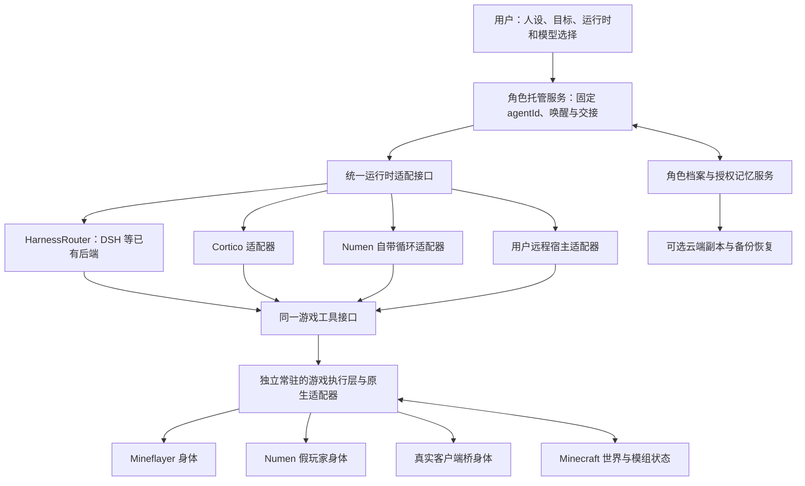

# Agent 角色托管、HarnessRouter 与记忆可迁移设计

日期：2026-10-22。最新状态：第二阶段已完成，详见 [实现、部署与验收](MY-AGENT-WORLD-HARNESSROUTER.md) 和 [运行时矩阵](HARNESS-RUNTIME-MATRIX-20261022.md)。下文保留研究架构和后续目标，不能将全部设计视为已交付。

已交付：`agent-mc-autonomy 0.1.26` 的可选 UHP 规划器、单控制器内的显式配置切换、独立稳定角色档案/历史库、按需检索与有哈希的导出；本机独立回环 Docker 服务已启动。真实线上 `qwen3.5-plus` 已完成 DSH → 直连 → DSH、游戏步行终态、同一身体连接及重连后的记录保留。初次格式失败与纠正记录均保留。

后续已更新为 `0.1.27`，修正便笺被工具交换挤出搜索及预览不含命中的问题。
26 个内置运行时已安装，23 个用 Token Plan/qwen3.7-plus 完成真实线上决策；
六种运行时在同一普通身体完成短距离移动、原动作终态和位置核对，修复后均能检索旧便笺。
一次快照滞后和一次 DSH JSON 格式失败及其纠正保留，不能推导长期自主生存成功率。

仍待做：Cortico/Numen 自带循环的 HarnessRouter 驱动、用户运行时选择页面、多用户档案 API、旧人物记忆迁移、导入与云端同步/恢复。旧 Cormy 私人资料没有导入，正式 FOM 未重启或切换世界。

## 结论

适合把 HarnessRouter 作为可选的运行时后端。用户提供角色人设并选择模型、运行时，服务器托管同一角色的持久身份、游戏资料、历史记忆、任务和动作回执。选择变化时，角色仍保留同一个 `agentId`。

需要把角色托管放在宿主服务层：`agent-mc-world` 继续负责游戏执行、历史游戏笔记和证据，不因此导入 Cortico、DSH、模型密钥或新的隐式规划循环。服务器提供的角色宿主和用户远程运行的宿主，都可以使用同一套工具与显式授权的档案服务。

## HarnessRouter 实际提供什么

研究基线：`HarnessRouter/harnessrouter` 的 `3668370c10255be7085bae207ace12a94422614f`，提交时间 2026-10-21，Apache-2.0。研究克隆留在本机 `E:\MC\research\harnessrouter-20261022`。后续实施使用锁定官方镜像，独立容器的来源、参数和状态见实现文档。

| 项目 | 研究结果与依据 |
| --- | --- |
| 选择运行时 | `metadata.harness_id` 选择已配置 harness；DSH 在 `gateway/app.py` 的 `_BASE_CATALOG`，并有 `runner/dsh_driver.py` 与官方 SDK 集成 |
| 任务生命周期 | 统一任务提交、流式进度、查询、取消、结构化失败、幂等重试；不是 Minecraft 动作已经成功的证明 |
| 会话与文件 | 支持持久会话和工作目录；自托管 `/data` 保存数据库、工作区和 CLI。数据库留存与角色可迁移是两个验收项 |
| 模型切换 | UHP 允许同一会话后续任务换模型，但必须在对应运行时和供应商实际支持范围内；不能把任意模型与任意 harness 的组合都视为可用 |
| Harness 切换 | 延续会话必须使用原 harness；不同 `harness_id` 与 `previous_response_id` 冲突时返回 `harness_mismatch`。配置的 `base` 也不可修改；需要新会话与交接 |
| Cortico / Numen | 当前基线没有这两个运行时的内置驱动。界面中的“自定义 harness”是配置已有 base，不等于注册任意运行时驱动 |
| 通用记忆 | 仓库的 UHP `2026-10-19/memories.md` 已设计记忆树、授权、版本、来源、检索与会话接线，是可选规范。当前 `gateway/app.py` 的 `UHP_VERSION` 仍为 `2026-09-28`，能力表没有 `memories`，未找到 `/v1/memories` 实现；不能描述为社区版已经交付完整记忆服务 |

部署时应读取实际实例的版本、capabilities 和模型支持，再选择可用功能。仓库存在较新的协议文件，不表示运行中的实现支持该协议的所有能力；`input_history` 等可选能力也不能仅凭文档启用。

## 分层与接入关系

图为目标架构。目前实现规划端口、本地角色档案和原控制器接线；DSH 只返回决策，由自研控制器派发原游戏工具。云同步、完整托管 API 和各宿主自带循环驱动仍待做；身体适配按各自已验证能力复用。

DSH、Cortico 是决策运行时；Mineflayer 是协议连接与执行生态；Numen 同时具有服务端身体和可选 Agent 循环。可以组合“DSH + Numen 身体”或“Cortico + Mineflayer 身体”。使用 Numen 身体不要求使用它自己的模型循环，同一身体只能有一个动作控制者。

对于 Cortico、Numen，第一阶段通过我们自己的小型适配器实现统一生命周期即可，不必先 fork HarnessRouter 把它们塞进内置驱动。之后可以根据维护成本决定是否实现 UHP 服务或贡献上游驱动。用户自带远程宿主也不必绕经 HarnessRouter 才能接入游戏。

HarnessRouter 的本地 CLI 按 turn 启动子进程，取消与超时会清理进程组及遗留子进程（`runner/server.py`）。因此常驻 Mineflayer 连接、动作账本和控制租约必须由独立游戏执行进程持有，不能依赖某个推理 turn 的子进程存活。临时 MCP/SDK 客户端只连接该执行层，退出不等于销毁身体或重放动作。

SDK、MCP 或 HTTP/CLI 是工具传输的可选适配；Mineflayer 仍通过 Minecraft 协议远程登录。采用 HarnessRouter 不构成把本机 Numen 管理 MCP 或 RCON 公开到公网的理由。

## 服务器保存哪些数据

| 数据 | 稳定身份与权威来源 | 切换运行时后的行为 |
| --- | --- | --- |
| 角色人设 | `ownerId + agentId`，有修订的人设档案；用户编辑与 Agent 经历分开保存 | 加载同一档案，保留名字、性格、偏好；改人设不会覆盖经历 |
| 私人经历与关系 | `agentId` 的私有历史记录，携带事件 ID、时间、说话者、来源与版本 | 已有本地宿主历史库及查询；尚非跨宿主公共服务 |
| 玩家资料 | 经过绑定的玩家身份；玩家自身偏好与互动记录、Agent 对玩家的记忆分别授权 | 不按昵称自动合并，不把一位玩家或 Agent 的私聊默认共享给全服 |
| 游戏笔记、方法 | 现有 `mc_memory`、方法和战术制品及其版本、证据；按世界/账号/Agent 隔离 | 复用原账本与数据目录，不另建一份竞争的游戏记忆实现 |
| 未完成目标 | 目标 ID、完成条件、实际状态、进度证据、接续摘要 | 交给新宿主继续判断；保存目标不等于后台自动执行 |
| 动作与事件 | 原动作账本、`action_id`、终态、事件游标、身体控制代次 | 重连先对账，未知结果保留未知，不能靠重新执行“确认” |
| 背包、等级、模组进度 | Minecraft 存档与对应模组的原生数据 | 保持原 UUID 和身体绑定；不能由记忆摘要重建或覆盖 |
| Harness 原生会话 | 对应运行时的私有会话、工作区、可选原文归档 | 同运行时可原生恢复；跨运行时以可移植交接为准 |
| 模型配置与凭据 | 用户授权的独立凭据存储，运行时只得到所需引用或短期授权 | 不进入人设、记忆导出、公共日志或默认云同步 |

现有 [游戏记忆](../packages/agent-mc-world/docs/game-memory.md) 已支持持久数据目录、修订、来源、作用域与显式远程检索。它当前仍以本地笔记为检索权威：第二台机器需要恢复相应本地笔记，远程索引并不提供完整自动导入。个人长期记忆还由宿主拥有，现有迁移工具也明确 `memoryAndPersonality: remain-with-host`。

第一阶段已有宿主本地档案、历史检索与导出；下一步再将跨宿主服务和 Cortico/Numen 自带循环接到这些契约。不能宣称改一个 HarnessRouter 配置就迁移了全部旧记忆。历史宿主数据先只读盘点与导出，转换后校验、保留原档，并由用户指定要迁移的角色。此前禁止将 Cormy 个人档案导入新桐人的约束继续有效。

## 身份与世界边界

建议明确区分以下标识，不从模型名、harness ID 或显示名派生角色身份：

- `ownerId`：注册用户，负责授权与导出；Agent 与真人玩家身份都可以归属或关联到用户。
- `agentId`：长期角色，模型和运行时变化时保持不变。
- `realmId + worldEpoch`：世界及其重置代次；跨世界可以共享人格，坐标、箱子与任务事实按世界隔离。
- `bodyBinding`：世界内的 `provider + playerUuid/bodyId`。更换身体提供方需要单独验证绑定与游戏状态迁移；换 harness 不自动等于换身体。
- `controllerGeneration`：当前控制代次，用于阻止旧宿主恢复后继续发送动作。
- `runtimeId + sessionId + modelId`：本次推理环境和会话；均可以更换，不作为记忆主键。

现有远程 `mc_memory` 的世界识别基于服务器地址，不能自动发现同地址换世界。第一阶段应保留其现有作用域与数据目录，另外记录明确世界绑定；不能直接修改哈希算法导致旧笔记不可达。世界身份升级需显式迁移映射，未经确认的旧坐标保持历史记录。

## 一次运行时切换

1. 暂停该角色的新决策和新动作提交，保留原游戏连接、身体与数据目录。
2. 等待当前动作终态，或显式取消后核对实际结果；取消推理任务不等于游戏动作已取消。待确认的交易、合成、消耗使用原 `action_id` 查询。
3. 写入交接快照：人设修订、记忆版本/游标、目标与验证条件、尚未结清动作、最近世界观测及原工具能力。历史和实时观测明确区分。
4. 释放旧控制者并推进控制代次；确保在途旧命令也会被执行层拒绝后，再让新适配器取得唯一控制权。
5. 在新运行时创建新会话，加载同一 `agentId` 的档案和按需记忆，查询身体当前状态；先对账再继续目标。
6. 原会话留作历史。失败时可恢复旧运行时，但不回滚已经发生的世界变化或重复提交动作。

可实现的承诺是“可导出记录不丢失、新运行时能查到并接续”。各框架内部压缩格式、隐式状态、模型 KV cache 和所有私有会话对象不能保证互相兼容；相同人设与经历也不能保证不同模型表现完全一样。

## 云端同步与恢复

先采用服务器本地权威存储和定期一致性备份，再加显式启用的云端副本。复用已有记忆提供方作为检索或整理后端，云同步独立处理完整记录、附件和版本，不把向量索引当唯一备份。

同步单位使用稳定记录 ID、递增版本、内容哈希、事件游标与幂等写入；只在完整快照及其清单均校验后推进恢复点。发生冲突保留双方分支和来源，动作账本或目标完成状态不能简单用“最后写入覆盖”。网络失败保留本地未同步记录，恢复后增量补发，并显示最后成功同步时间和缺口。

按用户与角色授权、加密传输和备份；私聊与玩家资料是否上云由所有者的明确设置决定。归档、撤销、删除和恢复策略需要在服务接口中体现，防止旧云副本把已撤销内容重新带回。角色所有者可导出人设、记录、任务、制品和清单，恢复时验证版本与哈希。当前没有完成云端账号连接或跨机器恢复验收。

Minecraft 的 `playerdata`、区块、模组数据库及外部玩法账本继续使用原有一致性备份流程；文件同步不能替代保存协调，也不能合并两台机器同时演化的世界存档。

## 最小接入契约与实施顺序

宿主层建议提供显式调用接口：`loadProfile`、`recall`、`appendEpisode`、`reviseNote`、`loadGoals`、`checkpoint`、`handoff`；这些是待定义的接口名，不是现有可调用 operations。写入携带预期版本和幂等键，写入者由认证身份确定，不能由模型伪装。人设指令由用户授权档案提供，检索的历史文本作为资料而非新增系统指令。

运行时适配接口提供 `capabilities/startTurn/stream/cancel/inspect/close`；游戏执行继续使用原 SDK / World Adapter 的身份、状态、动作和回执。模型调用保持在游戏 tick 外，角色托管服务负责显式启动的生活节拍、事件唤醒与目标接续，不再额外启动第二条决策循环。无需推理的移动、冷却与过程信息合并，危险事件及时送达。

实施顺序：

1. 用全新测试角色固定身份与数据目录，先以当前自研宿主打通档案、游戏笔记、目标和交接快照。
2. 单独启动固定版本 HarnessRouter 测试实例，通过 DSH 调用同一常驻身体的工具；Cortico 适配器并行使用同一契约。
3. 验证 DSH → Cortico → DSH 切换，之后接 Numen 自带循环。每项仅开放其经过验证的能力，缺失能力可见。
4. 完成导出/导入、断网补发、冲突与跨机器恢复，再开放可选云同步和面向用户的运行时选择界面。

## 验收与效率指标

完整目标验收计划应使用隔离世界和新角色，不使用现役 Cormy 的记忆或身体。本轮先在正式服用普通新账号验证无破坏步行/便笺接续，未完成下面全部跨宿主、物品消耗和云恢复计划：

1. 用户设定一个人设，角色实际与测试玩家交谈、完成一个带物品消耗的小任务；保存原始事件、记忆和真实动作回执。
2. 同一 harness 换一个其支持的模型，检查能否按需回忆原交谈和目标；检查身份、世界状态与物品变化。
3. 切到不同 harness 的新会话，保留 `agentId`、同一世界内原身体和历史记录；原控制者的新动作必须被拒绝。
4. 刻意断开模型或网络，在原 `action_id` 上查回结果，核对没有重复消耗、重复领取或再次挖掘；无法确认的结果必须明确未知。
5. 重启角色宿主后恢复，在另一台机器从导出/云端副本恢复；校验笔记版本、任务、事件游标与制品哈希，不宣称自动迁移内部会话。
6. 测试第二名用户和第二个世界，只能读取明确授权内容；旧坐标不能成为新世界事实。

沿用核心真实 `mc_trace`、任务终态与世界验证证据，分别统计：完成任务所需模型轮次、首次成功率、纠错轮次、重试/未知动作数、记忆检索命中与历史误用、token/耗时。HarnessRouter 的 `completed` 只表示推理任务结束，不能直接计为游戏目标完成。本轮已记录三个阶段 8 次规划调用、1 次真实移动及 1 次错误参数后的纠正，详见脱敏验收记录；样本不足以评估长期成功率。

## 来源与本地对照

- [HarnessRouter README](https://github.com/HarnessRouter/harnessrouter/blob/3668370c10255be7085bae207ace12a94422614f/README.md)：后端、调用方式、自托管与自定义 harness。
- [Gateway 源码](https://github.com/HarnessRouter/harnessrouter/blob/3668370c10255be7085bae207ace12a94422614f/gateway/app.py)：`UHP_VERSION`、`UHP_CAPABILITIES`、`_BASE_CATALOG` 和 `update_harness`。
- [DSH 驱动](https://github.com/HarnessRouter/harnessrouter/blob/3668370c10255be7085bae207ace12a94422614f/runner/dsh_driver.py)与 [Runner](https://github.com/HarnessRouter/harnessrouter/blob/3668370c10255be7085bae207ace12a94422614f/runner/server.py)：实际执行与进程生命周期。
- [UHP Sessions](https://github.com/HarnessRouter/harnessrouter/blob/3668370c10255be7085bae207ace12a94422614f/protocol/versions/2026-10-19/sessions.md)与 [Tasks](https://github.com/HarnessRouter/harnessrouter/blob/3668370c10255be7085bae207ace12a94422614f/protocol/versions/2026-10-19/tasks.md)：同会话模型切换和不同 harness 的边界。
- [UHP Memories 可选规范](https://github.com/HarnessRouter/harnessrouter/blob/3668370c10255be7085bae207ace12a94422614f/protocol/versions/2026-10-19/memories.md)：记忆授权、记录、版本和宿主接线；不当作当前社区版已实现。
- [现有核心组件边界](../packages/agent-mc-world/docs/component-boundaries.md)、[游戏记忆](../packages/agent-mc-world/docs/game-memory.md)、[Harness 与真实指标](../packages/agent-mc-world/docs/harness.md)。
- [现有身体适配器](../world/src/world-adapter/index.cjs)、[常驻角色与 Numen/Cortico 既有研究](MY-AGENT-WORLD-RESIDENT-KIRITO.md)。
