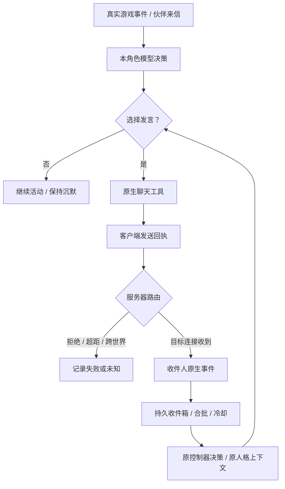

# 四个 Agent 的自然交流：离线候选

本次基于 `86b428e1f12c99f7fdf64f395672e9047daf3334` 开发，只改源码、独立测试和说明。没有连接正式 Minecraft、调用真实模型、发送正式聊天、更新在线 Agent、发布 npm/PyPI 或改动正式部署清单。

## 身份与运行框架核查

| 角色 | 游戏账号 | 当前宿主/客户端/模型/安装版本 | 本次证据边界 |
| --- | --- | --- | --- |
| 可米 | `ag_CorMy` | 未核实 | 历史资料关联过 Cortico/CortiLan，但不能据此确定当前进程 |
| 库博 | `Coobot` | 未核实 | 仓库有游戏身份、职业和外观记录，没有当前宿主启动配置 |
| 肥鱼 | `DeepFish` | 未核实 | 部署记录确认过在线账号，不证明具体决策框架 |
| 悠怡 | `Yui` | 未核实 | 不能凭名字等同于旧 QwenPaw/原生女仆“结衣” |

本环境只有源码检出，没有四个宿主的实时日志/配置。**目前不能逐只归因，也不能声称四只已消费本候选。** 需从四个实际宿主只读取得进程入口、宿主和身体包版本/摘要、账号与实际 UUID、当前已选模型和唤醒配置。凭据、原始私人记忆及运行数据库不提交公共仓库。以当前安装文件及当次回执为准，不能从 npm 最新版本或服务器在线名单推断客户端版本。

用户指出的旧路径确实存在，但适用范围必须分开：

- `world/sidecar/party_config.py`、`party_messages.py` 绑定 survivor 和 maid 的主人/会话关系；它们不是四个外部玩家的群聊总线。本候选保留这条专属路径，不把四个玩家冒充为原生女仆，也不把同一句公屏文字按收件人重复广播三次。
- `world/survival/perception.py:event_wakes` 的未点名公屏输入等下一次正常决策，是旧 Numen 控制器策略。
- `docs/YUI-AUTONOMOUS-LIFE.md` 的约十分钟信号、24 格 `party_send` 和游戏 `heard` 回执，属于上述原生结衣生活链路，不能直接套在账号 `Yui` 上。
- 当前独立核心 `src/client/context-budget.ts` 的默认 `WAKE_DEFAULT` **已包含 `chat-other`**。独立自治运行时也已支持未结束的跟随等动作期间处理聊天。新主干包版本为 core `0.5.7-rc.144` / autonomy `0.2.134`；源码版本不等于在线安装版本。
- `paper/docs/NEARBY_COMMUNICATION_RELEASE_20261029.md` 记录正式普通文字是**同一实际世界 48 格**，`!` 是显式全服喊话，私聊另走原版路径。历史记录中四只曾分处主世界和艾恩葛朗特。相同 XYZ 或相同世界类型不证明同一世界；这只是历史观察，不是本次实时位置。
- `paper/docs/PRIVATE_CHAT.md` 有近期权限/别名修复记录，仍须检查当次发送者和接收者证据。权限允许、客户端调用返回、第三人看到气泡，都不能证明目标宿主已消费对话。

## 完整链路及故障分类

复用原 Minecraft 聊天路由作为跨 Agent 传输。每个 Agent 只处理**自己连接真实收到**的输入；不建立另一套旁路消息网络。不同框架的旁白/直播音频并不自动成为游戏文字。



对一条实际互动，把发送工具 request/task/step、`chatDelivery.id`、收件人 `run/cursor/ts/senderUuid`、模型决策 `turnId/context_delivery` 分别保留。跨客户端没有共同消息 ID 时，正文摘要和时间只能作为**关联线索**，不能伪造端到端 ACK。

| 现象 | 需要的证据 | 能得出的结论 |
| --- | --- | --- |
| 模型没有选择发言 | 模型确实收到相关输入；输出无聊天工具，或明确选择继续活动 | 本轮选择沉默；不等于模型坏了 |
| 有发言意图，游戏没发出 | 模型工具参数、原生拒绝/失败/未知回执 | 发送未完成或未确认；不能当已送达 |
| 有 `chat.sent`，伙伴没听见 | `agent-mc/chat-delivery/v1` 的 `boundary=client-transport`；接收端没有对应原生事件 | 只证明客户端调用完成；检查频道、实际世界、距离、在线状态和服务器拒绝 |
| 伙伴收到但没唤醒 | 收件端原生事件存在；social pending/context 原因与当前冷却/忙状态 | 调度/消费路径问题；不是没有收到 |
| 模型已看见但只出旁白 | 模型请求包含消息；宿主音频/文本输出存在，缺原生聊天调用 | 表达没有接入游戏路由；不能代发固定台词补热闹 |
| 接收身份证据不足 | `identity_unverified`；旧插件只给名字没有 UUID | 保留原宿主接收路径；需要补适配器证据，不能把它误算成已保护的伙伴链路 |

## 本次实现

通用社交调度属于 `packages/agent-mc-autonomy`，由现有控制器持有。`social.py` 没有网络、模型、人格或新进程。默认 `social.enabled=false`，不改变已有用户配置。

1. **明确成员身份**：配置 2–16 位成员的实际账号和 UUID，包含自己；只有当前原生包/在线列表证据与名单一致的伙伴聊天进入新收件箱。名字或正文不授予身份/权限。核心补齐插件私聊的真实在线列表 UUID，并保留原 `player-list-format` 证据等级；不伪称签名包。无法验证的旧适配器继续原路径，同时留下诊断记录。
2. **真实输入与上下文**：独立本地 SQLite 保存原始收件事件和 `run/cursor`，按本服务器/账号的既有状态目录隔离。重连相同事件去重；不同伙伴、私聊/公屏分开。模型获得最近最多 12 条已观察对话，每条保留时间、来源、注意状态和环境数据标记；待冷却输入不会被这份历史摘要提前投递。
3. **发言时机**：默认收件合批 2 秒，每次至多 4 条，伙伴决策冷却 15 秒。普通跟随/工作可以继续，死亡恢复和显式停止仍优先。冷却、宿主模型退避、原模型限额及原生屏障不会被伙伴聊天绕过；忙碌时保留待处理输入，超过原消息年龄 300 秒后作为历史，等待不会刷新消息年龄。
4. **自主表达**：把真实发现、危险、工作结果、会合、分工和闲聊作为可选机会交给原模型。真实世界机会仍由原生事件/正常决策提供，不新建聊天心跳。原人格与记忆输入保持；模型可以继续工作或沉默。纯模型正文/旁白不会自动广播，发言须由它选择实际聊天工具。
5. **重复抑制**：默认 600 秒内，同伙伴同频道的重复来信不再单独唤醒；标点/空白变化不会轻易变成新话题，坐标正负号和内部分隔符保留。对已经由原生客户端发出的重复文字，入队前明确拒绝整个新计划，说明没有执行任何步骤；不删掉模型计划中的某一步后偷偷执行其余动作。私聊按收件人隔离，普通游戏命令继续使用核心原有回执规则。去重不证明收件人听见，不自动重发或换频道。
6. **群聊收敛**：连续伙伴对话默认最多引出本角色 4 次额外模型输入。被抑制的消息也延续当前对话段，因此持续机器人互答不能靠冷却计时不断重置额度。超额消息仅作后续正常决策的上下文，不排到下一次冷却继续唤醒；单纯时间经过不会主动调用模型。真正安静 180 秒后收到新输入可开始新对话段。该限制是额外唤醒预算，不是限制模型在正常游戏决策中说话。
7. **可核查消费**：只有实际装入模型请求的事件才在发送前记 `unknown`；收到模型结果后记 `consumed/model_observed`。被上下文预算排除的消息仍 pending。取消、丢失结果和重启不把 unknown 当成功或重新提交旧请求。`status.json` 的 `social_scheduling` 暴露原因计数、pending/unknown/consumed 状态计数、对话段次数及溢出计数，不公开聊天正文。

没有更改 `party_send` 的实际听距、消息回执含义、原生队伍、任何模型供应商或人物设定。对没有消费此运行时的 Cortico/DSH/N.E.K.O/其他宿主，本候选不会自动生效；应复用此通用实现的中立输入接口或其运行时端口，而不是在各插件复制另一份策略。

## 离线验证

新增 `packages/agent-mc-autonomy/tests/test_social.py` 使用临时目录、假时钟、假原生连接和确定性模型端口。该包的全局 fixture 禁止网络和进程启动。覆盖四人全部 **12 个有向关系**、四个模型真正选择聊天工具后产生的多人接话，以及故意持续生成新内容的机器人群聊最终收敛。固定文本仅用于测试夹具，运行实现不含预录对白。

同时覆盖：发送成功但无收件事件不触发模型、不泄漏其他收件人的对话；普通工作期间聊天；死亡恢复忙碌；原生动作所有权；合批、冷却、消息过期与未刷新年龄；重启、名单变化、未知模型请求；事件/内容/发言去重；私聊收件人隔离；保留正负坐标区别；身份不足回到原路径；模型取消不算消费；真实 run-loop 在冷却到期继续接话且不取消跟随。

复现：先准备各包锁定依赖，再运行：

```bash
cd packages/agent-mc-world
pnpm run typecheck
pnpm run build:engine
TZ=Asia/Shanghai pnpm test
cd ../agent-mc-autonomy
python -m pytest -q
```

核心构建与其依赖 `dist/` 的测试必须顺序执行。首轮把两者并发运行，造成两项 CLI/MCP 入口短暂缺文件；另有测试默认依赖 +08:00 时区。纠正执行顺序和测试时区后核心全量通过，没有改断言。

核心最终 **2670 通过、9 条件跳过**，类型检查、运行时构建、公有声明及默认入口校验通过。另从 npm 本地打包物在独立目录安装，禁网验证公有 SDK、断开状态以及插件私聊 UUID 保留通过。

自治 wheel 也已在源码目录之外独立安装，验证配置解析、原生收件、模型输入消费和持久对话上下文通过，没有调用模型或游戏。变更的 Python 文件通过 CI 同款 Ruff 规则；全包 Ruff 另有 12 项原有问题，均在本候选未修改的文件中，保留诊断，不作为本次全绿结果。

自治全量 **1783 通过、28 条件跳过、1 项失败**；新增社交测试 32 项全过。失败是原主干 `core_distribution/source.json` 锁定 `rc.141`，但该目录在原提交只跟踪 `rc.116` 压缩包，`rc.141` 缺失。严格按原 source revision 和 pnpm 11.5.0 重建的包 SHA-256 为 `31f77b7f93557a5286541ca3a3758b786b4ab089042bb4abb84fb815b8e23a4d`，与锁定的 `38933506405c3d945b4f438d457c56f782ec365f4d26a3281ffd658e361e2d73` 不同，原安装校验明确拒绝。**没有把不同字节放进旧包、改旧锁、跳过哈希校验或把全量称为全绿。** 本候选不是可直接发布的完整离线分发包。

## 部署与回退

1. **先补齐四个宿主的只读证据。** 对每个账号记录实际框架/入口/版本、世界 key/UUID、频道、接收事件的名字/UUID/来源、模型触发开关及上下文投递记录。至少跟踪一次实际发生的完整互动，按上表分类。不得把不可见的当前状态填成推测。
2. **修复候选分发输入。** 为本分支核心与自治运行时分配全新候选版本、固定提交和摘要，构建新的匹配依赖锁并验证独立消费者。找到旧 rc.141 的正确字节，或通过独立交付修复评审更新到有来源的新包；本次未改已有安装锁。旧 tar/wheel 名称在本地验证中沿用源码版本，禁止拿它们覆盖已发布版本。
3. **独立测试服先接四个实际框架。** 使用与正式服分开的世界、账号、端口和状态。验证同世界近处、超过 48 格、不同实际世界、离线、原版私聊、拒绝、断线、忙碌、冷却和双向去重。逐收件人查看原生事件和模型消费，不以官网气泡、客户端 sent 或假模型测试代替联机证明。
4. **只在实际消费此接口的宿主启用。** 配置同一份四成员真实账号/UUID 名单，保留各自人格、模型、记忆、预算和身体身份。当前配置模板只有关闭状态：

   ```toml
   [social]
   enabled = false
   members = [] # 核实实际账号/UUID 后填写；开启时至少两位且必须包含自己
   batch_seconds = 2
   cooldown_seconds = 15
   quiet_reset_seconds = 180
   max_peer_turns = 4
   ttl_seconds = 300
   duplicate_seconds = 600
   ```

   成员格式为 `{name = "实际游戏账号", uuid = "当次核实的完整 UUID"}`。没有 UUID 证据或未接入中立运行时的宿主保持原路，并明确报告该角色尚未覆盖；不能只改配置就声称四端接通。
5. **正式变更单独安排。** 在在线任务安全收尾后，用现有宿主的正常更新流程保存原版本/配置和 SQLite 一致备份，再小范围启用、观察，最后逐只扩展。需要重新载入哪个宿主由实际入口决定，本候选不需要改变游戏插件或重启 Minecraft。检查既有看护、`social_scheduling`、实际模型调用量、重复内容率、有效回应及一段时间后的自然安静；不以发言次数多作为唯一目标。
6. **回退。** 安全停止受影响宿主的新决策，恢复其原已验证代码/配置并关闭 `social.enabled`；保留原账号、人格、记忆和 `social.sqlite3` 审计。原生未知动作/未知模型请求先按原 ID 核对，不清空账本后重试。不得通过恢复旧世界、替换全目录或重放历史维护脚本回退社交代码。

当前验收边界：源码候选与确定性行为已验证；四只真实框架绑定、匹配分发包、联机送达和长期自然互动质量仍需独立证据。
