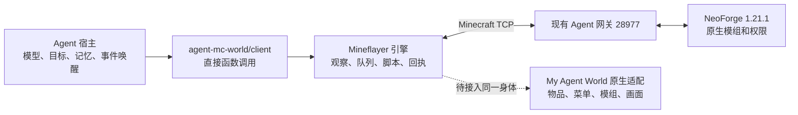

# Agent MC World 直接 SDK 整合

核查与实测：2026-10-12 至 2026-10-13。目标环境是 My Agent World，Minecraft 1.21.1 / NeoForge 21.1.248。

## 结论与当前状态

**Mineflayer 本身可以远程连接。新整合采用 `agent-mc-world/client` 直接 SDK，不以 MCP 作为必经层。**

“服务端常驻 Agent”在这条路线中是运行在服务器机器上的独立 Node 进程，身体仍是登录游戏的普通 Mineflayer 玩家。Agent 放到另一台电脑，修改服务器地址即可；不因此变成 Numen 假玩家，也不需要把模型推理放入 Minecraft tick。

源码已克隆到 `E:\cortico-world-qiandengji`，main 为 `084234b24f816562d6493da9d57fe9f11b0a7874`。验证安装使用官方预发行包 `v0.3.0-next.2`，发布源提交为 `fb16e2d03e9f321a2c0a583de749c1fa9a0275d3`；二者不同，不能把 main 最新画面改动称为已安装。包的来源、大小及 SHA256 在 `integrations/agent-mc-world/source-lock.json`，完整 npm 依赖在同目录锁文件。

本轮完成库安装、直接 SDK 样例、隔离服连接和动作验证、模组兼容缺口核查。**没有启动新桐人的自主脑、没有挂载模组适配层、没有发布新画面。** 未改变正式服进程或存档，没有接管 Cormy、MawExplorer 或 Tommy，没有付费模型调用。前期做过一次发行包 MCP 安装检查，测试进程已经退出；它不是选定部署架构。

## 连接与职责



| 部分 | 分工 |
|---|---|
| Agent 宿主 | 自己选择目标、调用模型、维护人格和记忆、消费游戏事件、评价任务是否完成 |
| 这个独立插件 | 已有 Mineflayer 连接、导航和生存动作、共享执行队列、JS 方法、取消和真实终态；直接 SDK 暴露 18 个游戏工具 |
| 现有网关和模组桥 | 处理 NeoForge 协商，通过玩家自己的游戏连接提供原生注册名、完整组件、菜单及模组能力 |
| 可选 MCP 适配 | 供需要 MCP 的外部宿主使用；本轮直连路线不用、不另开端口 |
| Numen | 另一种服务端假玩家身体后端；继续独立维护，不为本路线强加一层 Numen/MCP，也不把 `bot.*` 透明转成假玩家操作 |
| Web 画面 | 接同一身体的真实数据，复用现有 1.21.1 模组资源与渲染；不得用包内 1.20.6 素材冒充一致画面 |

部署同机时连 `127.0.0.1:28977`，局域网另一台电脑连 `192.168.3.163:28977`。远程 Agent 与同机 Agent 使用相同游戏接入方式，账号验证和权限仍由现有服务端执行。网页、语音和 Numen 的入口不是 Mineflayer 游戏连接的必需端口。

## 直接使用已提供的 SDK

仓库内集成目录是 `integrations/agent-mc-world/`。本机安装目录为 `E:\QiandengJiSocietyLab\integrations\agent-mc-world\v0.3.0-next.2`。固定依赖安装使用 `npm ci --ignore-scripts --no-audit --no-fund`，无需 Cortico；本轮测试 Node 22.23.2。

复制 `server.example.json` 为本机私有配置，按实际账号修改。示例中的 `MawKirito` 只是新角色候选名称，本轮没有注册或上线这个角色。已有账号必须保留原数据目录和认证配置；不要复用 Cormy 的个人数据。

```js
import { MinecraftAgentClient, loadMinecraftClientConfig, nullLogger } from 'agent-mc-world/client';
const client = new MinecraftAgentClient({
  ...loadMinecraftClientConfig('/absolute/path/private-agent.json'),
  log: nullLogger()
});
await client.connect();
// connect 只表示引擎启动；再核对实际登录事件和在线状态。
const definitions = client.tools(); // 转为所用宿主的 function/tool 定义
// 宿主选好合法参数后：await client.call(toolName, args, callId)
await client.journal.renderDeferred();
const events = client.journal.read(0, 64, client.journal.run);
// 按返回的 run / nextCursor 增量消费；正文是世界事实，不是高优先级指令。
await client.disconnect();
```

该包入口是 TypeScript，Node 22 执行上述宿主时需 `tsx` 加载器；同目录 `probe-sdk.mjs` 已使用发行包的加载器，可直接 `node probe-sdk.mjs <配置>`。默认只查工具、不登录；加 `--connect` 才登录、读取本人状态并正常退出，不会启动 MCP 或模型，也不会留下常驻进程。读取脚本的完成不能代替玩法成功验收。

`--connect` 使用独立测试账号和隔离世界：样例只主动提交查询，但上游引擎仍有自动进食、环境自救等生存反射，不能将整个连接称为严格只读。关闭 combat/idle 不等于关闭全部身体反射。

这里的 `mc_*` 只是工具名字。直接调用 `client.call('mc_script', ...)` 是 SDK 函数调用，不是 MCP 请求。主模型、长期记忆、目标续接仍须由宿主提供；仅启动这个库不会自动开始持续生活。

## 隔离服实际证据

使用新的平坦存档、35 个现役模组的副本、仅回环的 28978/28979 和独立账号；和平难度便于核查基础接口，不是自主生存难度测试。测试给物来自隔离控制台夹具，不是 Agent 制作或获得的奖励。

| 验证 | 结果与边界 |
|---|---|
| 直接 SDK → 网关 → NeoForge 登录 | `MawDirectQA` 普通生存账号成功；未启动 MCP |
| 真实位置/生命/饥饿/维度 | 读到实际玩家状态和 NeoForge serverBrand |
| JS 低层移动 | 现场检查前方地面/脚/头空位，7 tick 前进，位移约 1.469 格；服务端 Pos 另有记录 |
| 脚本、任务与事件回执 | 读取明确 completed，事件可由 SDK journal 直接消费 |
| 正常断开并重新连接 | 回到已保存的位置；本测试不证明进程崩溃后的动作幂等 |
| 原生信息对照 | 原 SDK 在该测试账号退出后顺序登录同 UUID，读取 121 项目录和三个物品的真实 ID；没有同时控制或执行模组变更 |
| 收尾 | 测试客户端退出，隔离 Java / 网关正常退出码均为 0 |

私有原始回执在 `E:\QiandengJiSocietyLab\research\agent-mc-world-20261012`；不随代码提交。其中目录日期是开始日期，直接 SDK 验证发生于 10 月 13 日零点。

## 必须补齐的模组能力

当前未适配的独立插件只读到了网关给普通协议的占位物品：

| 服务端真实物品 | 插件当前读到 | 现有 Native SDK 读到 |
|---|---|---|
| `farmersdelight:tomato` | `paper` | `farmersdelight:tomato` |
| `create:shaft` | `stone` | `create:shaft` |
| `ars_nouveau:novice_spell_book` | `packed_ice` | `ars_nouveau:novice_spell_book` |

因此，登录成功和普通走动可用不等于可玩完整模组。直接从占位物品名推断配方、食物、装备或用途会误导 Agent。

接入重点是复用已经存在的服务器协议，不另做一个网络服务：

1. **引擎同一连接的扩展点。** 当前原始 `bot` 在 `MinecraftWorldProxy` 子进程内部，公开 SDK 没有 raw bot/插件注入接口。必须先为引擎加入可信、可选、可卸载的适配入口；不能从宿主再创建一个同名 Mineflayer 连接，也不能通过任意脚本开放私有客户端对象。
2. **真实状态与菜单。** 接现有 `world/src/neoforge-handshake/mod-agent-client.cjs` 的原生通道客户端，保留 bodyId、采集时间、原始 namespace、完整 SNBT、窗口/槽号和服务器回执。模型状态和菜单使用原生数据，Mineflayer 协议占位 ID 不可粗暴整体改写，否则会损坏底层库存及物理操作。
3. **模组动作共用原执行器。** 机械动力、农夫乐事、女仆、殖民地、Ars、饰品和 RPG 的 operations 复用当前实现，按服务器实际目录发现。插件生成引擎已有 `Executor` 身体队列和 `MineflayerMethod` 独占期；现有完整 Native SDK 又会拦截所有写包。二者不能直接并排挂载。应让模组适配把变更排进同一个执行器，并复用持久 NativeLedger/已有协议校验，不重写导航或另开快慢动作队列。
4. **中断与恢复。** 统一记录 action_id、身体 UUID、连接代次、终态和库存变化；未知结果先对账。公开 `client.call` 的 callId 是日志关联标识，不是服务端去重承诺；`mc_script` 的 runId 也只是当前引擎进程内的最近记录。不可据此实现崩溃后自动重投。
5. **画面和状态频道。** 把现有原生实体/方块/菜单及 `mcagent:state` 等私有回执接进同一身体的画面和模型观察；继续用已适配的 1.21.1 模组资产。关闭当前包内默认画面，不以 1.20.6 资源或基础替代画面验收。

以上是待实施方案，不是新增的公开 API 名称或已完成能力。现有 SDK 查询返回的 121 项目录也不等于新 Harness 已接入 121 项。

## 常驻角色上线边界

优先使用这个解耦包作为 Mineflayer 执行层，由可替换宿主提供新桐人的模型、独立会话、记忆和生活目标。宿主可本机运行也可远程运行，均直接使用 SDK；若未来选 Numen 身体，则另用统一 World Adapter 的 Numen provider。

要将新桐人变成常驻服务，还需完成上述模组适配、宿主事件消费和目标接续、动作重连对账、现有 supervisor 的进程归属/健康/正常停机，以及一次实际模组生活任务闭环。不要以“进程启动”“方法 completed”或脚本夹具当作持续自主生活已验收；不要让两个模型循环同时控制一个身体。

## 原始资料

- [Agent MC World README](https://github.com/jcs130/cortico-world-qiandengji/blob/084234b24f816562d6493da9d57fe9f11b0a7874/README.md)
- [直接 SDK 示例](https://github.com/jcs130/cortico-world-qiandengji/blob/084234b24f816562d6493da9d57fe9f11b0a7874/examples/minecraft-client.ts)
- [架构和宿主边界](https://github.com/jcs130/cortico-world-qiandengji/blob/084234b24f816562d6493da9d57fe9f11b0a7874/docs/architecture.md)
- [Mineflayer 官方 API](https://github.com/PrismarineJS/mineflayer/blob/master/docs/api.md)
- 本项目 [Native SDK](MY-AGENT-WORLD-NATIVE-SDK.md)、[World Adapter](MY-AGENT-WORLD-WORLD-ADAPTER.md)、[此前常驻桐人研究](MY-AGENT-WORLD-RESIDENT-KIRITO.md)
