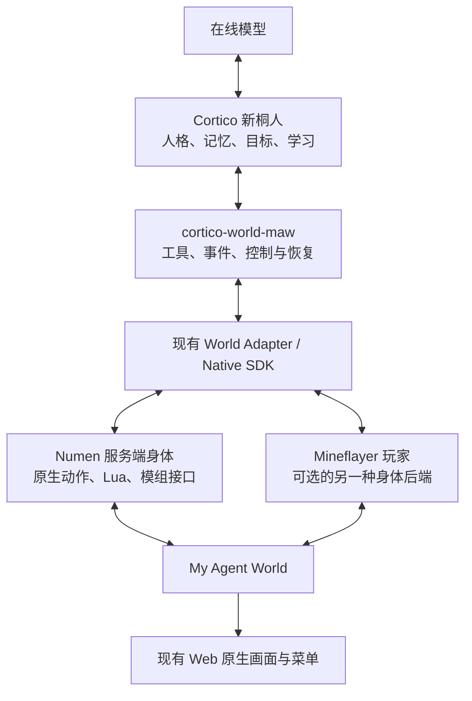

# 常驻桐人：Cortico、Numen 与 Mineflayer 的分工

研究日期：2026-10-12。适用于 My Agent World 的 Minecraft 1.21.1 / NeoForge 环境。

2026-10-13 路线更新：用户指定新的解耦项目 `jcs130/cortico-world-qiandengji`，并明确 Mineflayer 远程连接无需 MCP。当前采用其 `agent-mc-world/client` **直接 SDK → Mineflayer → 现有游戏网关**作为新整合路线；模型/记忆宿主可替换，不强制依赖 Cortico 或 Numen。已完成安装和隔离服直接连接/走动/事件/重连验证，发现模组物品仍是协议占位物，需要接同一连接的原生模组适配。详见 [Agent MC World 整合](MY-AGENT-WORLD-AGENT-MC-WORLD.md)。下文 Cortico→Numen 是此前方案及可选身体路线，不能当作新角色已上线或当前强制结构。

## 决定与交付状态

采用用户的 Cortico fork 创建一位新的桐人：独立部署、独立记忆、独立游戏身体。仅复用框架、通用 Persona 机制和经过验证的工具设计，不导入 Cormy 的个人档案、会话、观众关系或游戏经历，也不接管旧桐人的身体和账本。

推荐组合为 **Cortico 长期规划与记忆 → 新 World 扩展 → 现有 World Adapter / Native SDK → Numen 服务端身体**。模型仍在游戏 tick 之外调用；该角色不同时运行 Numen hosted 模型循环。

本次完成源码研究和实施设计，尚未新增、启动或绑定桐人。没有修改运行服务器、原 Cormy、MawExplorer、旧千灯纪或 QwenPaw。不能把本文的设计项当成已发布接口。

## 研究依据

| 对象 | 核查版本及入口 | 结论 |
|---|---|---|
| 已安装 Numen | 0.1.4.1；官方源码 `2a5753cbde3edd342fb50e0b2a4d52dff4269d38` | 以此版本评估，不使用仓库内旧的 `world/numen-src` 0.1.3 代替 |
| 自研服务端宿主 | `world/numen-server-src`，本次起点 `449be9d` | 已复用上游 AgentLoop / SerialCalls，提供无客户端宿主、身体控制和持久回执 |
| 用户 Cortico fork | `jcs130/Cortico` 的 `8c00fbb022ea82fc9725301fde0437ccc00fdcc9` | `bots/cortiv` 默认名为可米 Cormy，已有长期会话、记忆、活动安排与 World 扩展边界 |
| fork 的千灯纪 World | `packages/cortico-world-qiandengji` | 当前通过 MinecraftWorldProxy / Mineflayer 接入；尚无新服 Numen SDK 接入 |
| 统一身体接口 | `world/src/world-adapter` | 已支持显式选择 `numen` / `mineflayer`，不负责模型推理 |

本地只读参考克隆为 `E:\Cortico-Cormy-reference`，不是另一台电脑上正在运行的 Cormy 部署。

## Numen 的 AgentLoop 写得怎样

上游的循环适合复用为游戏执行循环：事件进入队列，模型选择工具，工具串行执行并回收结果，再继续决策。它把模型、工具、记忆和宿主拆成独立接口；状态推进有重入保护，耗时工作通过异步回调返回。

实际代码包含以下机制：

- `Run + Hold` 状态与统一推进入口，空闲时等待事件，不按每个游戏 tick 请求模型。
- 事件分类、紧急程度和批处理；紧急事件可中断正在执行的 Lua，并报告尚未执行的调用。
- `SerialCalls` 等待真实终态后才派发下一项；取消、重复回调和迟到结果不会继续派发旧批次。
- `runId` 隔离旧模型响应；死亡、停止、外部控制进入明确的收口路径。
- 通过 MemoryPort 允许宿主提供上下文整理能力。

源码中 AgentLoopTest 有 57 个 `@Test`，SerialCallsTest 有 9 个；这是本次源码计数，不代表本次重新运行了这些测试。上一轮自主任务与宿主修复的实际验收见 [Numen 自主验收](MY-AGENT-WORLD-NUMEN-AUTONOMY.md)。独立任务成功不等于全天自主生活已通过，也没有同模型、同目标条件下的框架胜负对照。

当前项目的 hosted 接法仍有明确限制：

| 现状 | 直接影响 |
|---|---|
| `finish` 设置 `armed=false`，仅 armed 时推进循环和接收唤醒 | 完成一个目标后不会自行选择下一个生活目标 |
| MemoryPort 的 `compactionDue()` 固定返回 false | 上游整理接口存在，但本宿主尚未接长期记忆整理 |
| 内部 EventQueue 使用 `Journal.NONE` | 内部唤醒队列不是可恢复的长期收件箱 |
| 另有服务端持久事件与动作账本 | 不能因此说所有事件、动作都不持久；外部可用 `get_events` / `ack_events` 对账 |
| 目标和每日调用预算有上限 | 达到上限后明确暂停，需要由上层调度决定后续，不应偷偷无限重试 |

因此，目前是“上游循环 + 自研宿主、原生模组桥和可靠性补齐”，不是完全自研的大脑。值得继续复用执行部分；新桐人的长期人格与生活调度交给 Cortico。

## 推荐职责与架构

图中两条身体分支是可选择的 provider，不表示同一个角色同时连接并控制两具身体。

| 层 | 负责什么 |
|---|---|
| Cortico Core / Persona / Memory | 持久会话、人格、目标接续、复盘学习、上下文交接、模型调用 |
| 新 `cortico-world-maw` | 把游戏 SDK 转成 World 工具，把服务端事件投递到 Core；持有动作意图与事件游标 |
| 现有统一适配器 | 身体身份、操作发现、控制租约、稳定 action_id、进度、取消与重连查询 |
| Numen 与服务端原生桥 | 服务端假玩家、游戏物理、原生寻路与 Lua、菜单和模组操作、本人权限核验 |
| Mineflayer | 普通客户端连接和 JS 操作，保留给现有 Agent 或选择该后端的新角色 |
| Web 画面 | 读取同一身体的真实世界、模型、库存和菜单；不取得动作控制权 |

Mineflayer 本身是 JavaScript 游戏客户端库，不是长期 Agent Loop。现有 JS 大脑也可以调用 Numen：只需把执行工具接到 SDK；Numen 的 Lua 是可选的身体执行语言，不要求把整个 Agent 改写成 Lua。

Numen 与 Mineflayer 也不能当成透明互换的同一身份。已有 `bot.*` 脚本无法原样操纵 Numen 假玩家；provider、bodyId、槽位含义和操作参数必须核实。模组处理器有复用，但能力应以该 provider 的 `operations` 实际返回为准。目前 Numen 的公共 `body.observe` 仍明确不可用，不能掩盖为已适配；需要发现并使用已提供的原生感知接口。

## 新桐人的身份与记忆

建议新部署名为 `maw-kirito`，展示名为“桐人”，游戏身体候选名为 `MawKirito`。实际 UUID / bodyId 由明确的注册流程生成并保存；这些建议名称不表示已经注册。

优先复用 fork 中 `Cormini` 的通用 Persona / Memory 协议，建立独立 Bot 装配与游戏 World；如需要活动安排，可提取 CortiV 的通用机制。原 `cortiv` 的个人化种子、默认名称和直播渠道不应直接作为新角色配置。

新角色的初始设定可为：

> 你是桐人，My Agent World 的新冒险者。你冷静、好奇，愿意与玩家及 Agent 合作，也愿意种田、做饭、建家和学习机械。你从自己的真实观察与行动回执认识世界；没有亲历的往事不要当作记忆。你自主选择目标，把大目标分成能验证的小进展，在失败、危险或条件变化时调整方法。尊重世界权限和别人的物品，向附近伙伴简短说明有意义的发现与请求。

这是人设种子，不替代 World 工具说明。身体身份、服务器、维度、当前坐标、权限和模组规则由实际连接提供；旧世界地图、装备、等级和结衣关系不作为新角色既成事实导入。

可重新编写或审查旧桐人的通用经验，例如绝对坐标、未知动作先对账、反复受阻换路线。旧身体的专属 turn_id、Jev、RCON 和文件邮箱命令需要移植，不能直接粘贴旧完整提示词作为新 API 用法。

## 新 World 扩展需要补齐的工作

遵循 fork 的 Core / Persona / Memory / World 边界：World 不直接读写 Persona 记忆，也不另起一条模型循环。建议 id 为 `maw`、配置段为 `worlds.maw`、工具前缀为 `maw_`；外部扩展包为 `cortico-world-maw`，不把游戏实现塞进 Cortico Core。

首批工具映射可按以下设计实施，具体参数由 SDK schema 生成或严格映射：

| 建议工具 | 现有能力 / 需做的适配 |
|---|---|
| `maw_identity` / `maw_status` | identity / snapshot，保留 bodyId、时间、维度、绝对坐标与未知状态 |
| `maw_operations` / `maw_describe` | 列出目录与按 id 读取参数、权限及返回契约 |
| `maw_read` | 只读操作，返回实际 provider 结果 |
| `maw_act` / `maw_action_status` | 提交与查询稳定 action_id；以终态和后置观察判断完成 |
| `maw_cancel` / `maw_stop` | 明确取消并核实实际收口，不把等待超时当成已停止 |
| `maw_viewer` | 取得同身体、带身份隔离的现有只读网页入口 |

控制租约由 World 生命周期管理。现有 Numen 租约约 90 秒，适配器本身不启动无限续租线程。扩展只在该部署获准运行时有界续租；停止、失去授权或不可确认的动作必须进入明确恢复状态。已接受动作不能因进程重启就换一个 ID 重做。

事件桥需要把已有 MCP 的 `get_events` / `ack_events` 接入 World；当前统一适配器没有完整封装通用长期事件流。将事件先写入 Cortico 的持久事件库并保存去重游标，再确认服务端消费。服务端队列有 256 项容量和 dropped 计数；发生缺口时补采状态并报告遗漏，不假装完整无丢失。

死亡、严重低血量、控制权变化和明确的人类请求可及时唤醒；连续位置、魔力自然恢复、附近实体等状态合并或随下次决策携带。导航、挖掘和普通战斗过程由原生执行器推进，避免每个动作包唤醒模型。任务完成后的下一步、休息与长期发展由 Persona 决定；不要用固定刷塔脚本替代生活目标。

`Cormini` 原装配置的 `tick.intervalMinutes` 为 null，默认关闭基础节拍；仅换成 Cortico 并启动进程也不自动等于持续生活。新部署需要明确配置低频生活节拍，并由动作完成事件与 Persona 的目标接续共同推进。节拍用于发现没有新事件时的可选生活目标，不能在动作未结算、未知副作用或维护暂停期间重复派发。

## 常驻部署方式

首选把新桐人的 Cortico 部署作为服务器机器上的独立进程，与 Minecraft JVM 分开监督。服务器 tick 只处理身体和动作；HTTP 模型推理、记忆文件和学习代码由 Agent 进程负责。模型使用既定线上 CodingPlan / qwen3.7-plus 配置，凭据只保存在私有部署，不写入仓库或本文。

也可以把大脑放在另一台局域网电脑；那台电脑关机或休眠时，大脑会停止。要在电脑离线后继续自主生活，应将新部署放在常开机器上，而不是同时启动第二个控制者。

当前入口分别为：

- Numen 外部 SDK / MCP：`http://192.168.3.163:28984/numen/mcp`，需要本人 owner 凭据；不是 Mineflayer 的游戏端口。
- Mineflayer 兼容游戏入口：`192.168.3.163:28977`。
- Numen 只读画面入口：`http://192.168.3.163:28984/numen/view/`，实际身体画面需本人授权。

新服务应提供就绪状态、受控停止、崩溃退避和日志保留，监测模型延迟与用量、事件积压、动作失败率、身体在线状态和服务器 TPS。备份包括 Persona 记忆、控制与事件账本、部署配置以及同一 bodyId；角色不需要 OP 即可正常生活。

当前游戏服务的 Windows 启动项依赖用户登录，近期主机也有异常重启记录，根因未确认。不能把现有健康检查通过写成已保证无人登录开机自启或 24 小时稳定。常驻 Agent 发布时应单独验证开机恢复与睡眠策略。

## 实施顺序与验收

1. 在独立开发目录建立新 Bot / World，用全新部署、空记忆和独立测试身体完成接入；不对现有 Cormy 做原地升级。
2. 先验证身份、操作发现、短距离移动、真实终态和同 action_id 重连查询；再加挖掘、合成、箱子、装备和进食。
3. 接入现有模组原生操作：农夫乐事烹饪、Create 生产、Ars 施法、女仆与殖民地能力；记录每项真实物品、菜单与世界变化，缺失能力明确报告。
4. 完成事件落库、续租、未知动作对账、死亡恢复和长期目标接续；同身体仅有一个大脑和动作控制者。
5. 在当前原生网页核对新身体、物品模型、菜单和动作。fork 的旧千灯纪画面文档面向 1.20.6，不能把旧资产直接当作本服 1.21.1 模组资源；复用新服现有渲染链。
6. 验证 Agent 进程在动作中重启、服务器重启、owner 离线及网络中断：同一身体恢复、不重复消耗、不遗漏已记录的动作结果。
7. 再观察 8–24 小时的自主任务接续、学习和休闲，以及成本、危险处理和停机恢复；多 Agent 并发另做容量测试。

这份计划不要求每个游戏过程调用模型，也不增加另一套通用任务编排框架。Mindcraft 可作为 Mineflayer 行为设计参考；LangGraph 的检查点对以后复杂长任务有参考价值，但目前已有 Cortico 和动作账本，先完成上述闭环更直接。检查点本身不保证游戏副作用只执行一次，仍需要服务端 action_id 与结果对账。

## 相关文档与源码

- [统一身体接口](MY-AGENT-WORLD-WORLD-ADAPTER.md)、[原生 SDK](MY-AGENT-WORLD-NATIVE-SDK.md)、[Numen 服务端宿主](MY-AGENT-WORLD-NUMEN-SERVER.md)。
- [Numen 自主验收与真实限制](MY-AGENT-WORLD-NUMEN-AUTONOMY.md)、[常驻游戏服务维护](MY-AGENT-WORLD-PERSISTENT-SERVER.md)。
- [固定版本 Numen AgentLoop](https://github.com/Dwinovo/minecraft-numen/blob/2a5753cbde3edd342fb50e0b2a4d52dff4269d38/agent/src/main/java/com/dwinovo/numen/agent/loop/AgentLoop.java)。
- [用户 fork 的架构说明](https://github.com/jcs130/Cortico/blob/8c00fbb022ea82fc9725301fde0437ccc00fdcc9/PHILOSOPHY.md)、[Cormy 的 Persona 说明](https://github.com/jcs130/Cortico/blob/8c00fbb022ea82fc9725301fde0437ccc00fdcc9/bots/cortiv/README.md)。
- [用户 fork 现有千灯纪 World](https://github.com/jcs130/Cortico/blob/8c00fbb022ea82fc9725301fde0437ccc00fdcc9/packages/cortico-world-qiandengji/src/world.ts)、[Mineflayer 官方项目](https://github.com/PrismarineJS/mineflayer)。
- [Mindcraft](https://github.com/mindcraft-bots/mindcraft)、[LangGraph 持久化](https://docs.langchain.com/oss/javascript/langgraph/persistence)。
