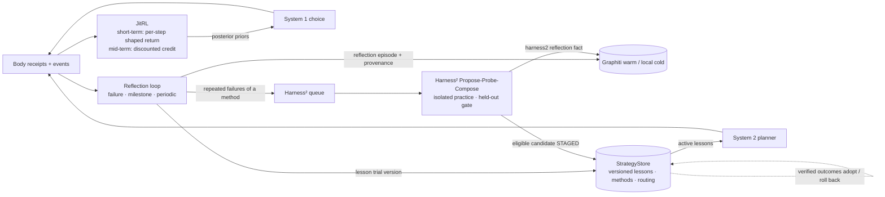

# Agent Harness Runtime — design (active direction: Python)

Status: **Phase 1 implemented** in `packages/agent-harness-py` (package `agent-mc-harness-py`, import `agent_mc_harness`)
on branch `feat/agent-harness-phase1`, local commits only. The earlier TypeScript harness (gateway + body adapters,
`packages/agent-harness`) stays in the tree and passing; its design is kept in
[agent-harness-design-ts.md](agent-harness-design-ts.md) and its wire protocol in
[agent-harness-protocol.md](agent-harness-protocol.md) (the Python gateway speaks a subset of it). New work goes to
Python. **Every feature flag defaults off**: importing the package or leaving the env unset changes nothing.

## 1. Three layers

```
┌──────────────────────────────────────────────────────────────────────────────────────┐
│ HOST AGENT  (persona, dialogue, decides WHAT; N.E.K.O / Cortico persona / DSH)         │
│   lightweight messages: hello · submit_intent · update_intent · control · get_summary   │
│   · pull_events · get_body · ping   (protocol.handle; never calls mc_* tools directly)   │
└───────────────────────────────┬──────────────────────────────────▲─────────────────────┘
                                ▼                                  │ summary / events
┌──────────────────────────────────────────────────────────────────────────────────────┐
│ HARNESS RUNTIME (runtime.py, scheduler.py, fastslow.py, learning/*, memory/*)          │
│   goals: Intent queue (priority, pause/resume/cancel, needs_host)                      │
│   scheduling: S0 reflex/rules → S1 fast typed choice (+JitRL) → S2 LLM planner          │
│   single BODY LEASE · worker pool (reflection / review / research / Harness²)          │
│   memory: Hot (ring) · Warm (Graphiti bi-temporal) · Cold (local SQLite archive)        │
│   learning: reflection (resident) · self-iteration store · JitRL · Harness²            │
└───────────────────────────────┬──────────────────────────────────▲─────────────────────┘
                                ▼ BodyAction                       │ BodyEvent / ActionReceipt
┌──────────────────────────────────────────────────────────────────────────────────────┐
│ BODY ADAPTER (body/base.py BodyAdapter, body/safety.py GuardedBody)                    │
│   perception events · actions + receipts · lifecycle · capabilities · identity scope    │
│   NumenBody (native MCP via numen_controller / hosted via mc_numen) · MaidBody (mc_maids)│
│   Mineflayer adapter: deferred (exists in the TS harness)                              │
└──────────────────────────────────────────────────────────────────────────────────────┘
```

The harness is the server-hosted runtime: while it executes, it **exclusively** drives the body (one lease). Third-party
agents talk to it only through messages.

## 2. Interfaces (Pydantic / Protocol)

Body (`models.py`, `body/base.py`) — mirrors the TS `agent-mc-body/v1` contract field for field:

```python
class BodyAdapter(abc.ABC):
    kind: BodyKind                                   # "numen" | "maid" | "mineflayer"
    def identity(self) -> BodyIdentity | None        # kind, body_id, name, owner_id, world: WorldRef, scope: Scope, generation
    def capabilities(self) -> Capabilities           # actions{verb: ActionSupport}, native_actions, events, snapshot, lifecycle, perception, safety, limits
    def lifecycle(self) -> LifecycleState            # detached|spawning|ready|dead|reconnecting|error|destroyed
    async def spawn(self) -> None                    # attach/bind an EXISTING companion; never creates/deletes one
    async def reconnect(self) -> None
    async def destroy(self) -> None                  # release control; the companion is kept
    async def act(self, action: BodyAction) -> ActionReceipt     # BodyAction{verb, args, name?, request_id?}
    async def result(self, request_id: str) -> ActionReceipt     # reconcile accepted/unknown; never replays
    async def stop(self, reason: str | None = None) -> ActionReceipt
    async def snapshot(self) -> BodySnapshot         # life_state, position, dimension, health, food, inventory, entities, text
    def subscribe(self, listener: Callable[[BodyEvent], None]) -> Callable[[], None]
    def health(self) -> BodyHealth

ActionStatus = "completed"|"accepted"|"failed"|"rejected"|"unsupported"|"blocked_by_safety"|"unknown"
ActionReceipt(request_id, verb, status, terminal, text, execution_id?, data?, retry_allowed=False, retry_after_ms?)
BodyIdentity.group_id() -> "<kind>_<server>_<sha256(kind,server,world,body,realm,account,agent)[:20]>"  # memory partition
```

Runtime (`runtime.py`): `Intent(id, agent, goal, priority, steps, candidates, state, decision, verified, strategy_refs…)`,
`PlanContext(capabilities, memories, hot, lessons, decision, snapshot, recent)`,
`Planner = Callable[[Intent, PlanContext], Awaitable[list[Step] | None]]`,
`Verifier = Callable[[Intent, BodySnapshot], Awaitable[bool | None]]` (environment evidence for goal success).
`HarnessRuntime(body, planner, memory, execute, fastslow, verifier, strategies, reflection, review_interval, max_workers…)`.

Scheduler (`fastslow.py`, `scheduler.py`, `typed_choice.py`): `Candidate(id, description, step, prior)`,
`Decision(tier, route, focus, profile, system1, requested_tier, effective_tier, defer)`,
`SystemOneClient.request(state, questions) -> {answers: {key: TypedChoice}}`, `BodyLease.hold/preempt/valid`,
`WorkerPool.submit(kind, job)`, `BrainMetrics.view()`.

Memory (`memory/*`): `MemoryEpisode(id, kind, name, body, source_description, reference_time, actors, provenance)`,
`Fact(fact, source, valid_at, invalid_at, score, data, provenance)`, `MemoryStore` protocol (`add/search/close`),
`MemoryRouter(local, graph).add/search/hot/observe`.

Learning (`learning/*`): `ReflectionLoop.reflect(ReflectionInput) -> Reflection | None`, `Reflector` protocol,
`StrategyStore.propose/active/record/rollback/start_trial`, `JitRL.rank/record_step/credit/stats`, `GoalWeights`,
`Harness2Optimizer.optimize(...)`, `Proposer` protocol.

Gateway (`protocol.py`): `await handle(runtime, {"v":1,"id","type","payload"}, agent=…, admin=…) -> reply` for
`hello · ping · submit_intent{goal, priority, constraints{steps?, candidates?}} · update_intent · control{pause|resume|cancel|get|list}
· get_summary{topic?, maxChars} · pull_events{after, limit, minSeverity, kinds} · get_body{include}`. Transport-agnostic
(the TS gateway's WebSocket/stdio framing can carry it); ownership: an agent controls only its own intents unless admin.

## 3. Scheduling tiers

| Tier | What | Where | Rules |
|---|---|---|---|
| **System 0** — body-native reflexes | low HP / hunger, collision, emergencies, native work running; anti-cheat stop | the body itself (Numen/maid native AI) + `GuardedBody` + `FastPolicy.rule_focus` | ms-level, **not preemptible**: when focus is `survival`/`wait` the harness defers (`defer_seconds`, capped by `max_defers` → pause for host); safety events `preempt()` the lease so late results of the holder are discarded |
| **System 1** — fast decisions | typed choice over 2–8 exact candidates; adaptive_router L0–L1; JitRL posterior | `FastSlow.system1` → survivor `PolicyWorker`+`SystemOne` (gateway tools) or `SystemOneClient` (/systemone, any body) | one request, no retries, deadline (default 5 s), `choice_probability ≥ 0.75`, **fresh snapshot re-check** (`same_body`/premise) → else escalate to S2. Bypasses the worker queue |
| **System 2** — slow thinking | LLM planner, reflection, memory updates, Harness² | `Planner` hook + `WorkerPool` | per-request **thinking tier** (`no_think/normal/complex`): typed judge `answers.reasoning` (immediate/routine/deliberate) when confident, else router level / `DecisionSettings` profile; danger/complex never lowered; output budget from `decision_profiles` |

Routing levels come from `world/survival/adaptive_router.route` (L0 SKIP · L1 FAST · L2 THINK · L3 PLAN). Metrics
(`BrainMetrics`, after cormy brain-metrics): decisions per tier, requested vs effective thinking tier, System-1
ok/escalation codes and median latency, goals `completed_verified` vs `completed_unverified`, deferrals to native.

## 4. Memory: Hot / Warm / Cold

The **Episode** (`MemoryEpisode`) is the only input unit; every episode carries `provenance`.

* **Hot** — per-`group_id` in-process ring (32), newest first; given to the planner as `PlanContext.hot`. No I/O.
* **Warm** — Graphiti, bi-temporal (valid/invalid + created/expired), **in-process via the existing sidecar class**
  `agent_memory_sidecar.service.GraphitiService` (Kuzu driver, Minecraft entity types, point-in-time search). Provenance
  travels in `source_description` (EpisodeIn has no extra fields). Needs an extraction LLM; without one `add` is skipped.
* **Cold** — local SQLite (`LocalMemory`): always written, keeps provenance JSON, lexical recall (word + CJK bigram).
  It is the fallback whenever Graphiti is off, unconfigured or failing (`MemoryRouter` dual-writes; errors counted).
* Isolation: `group_id` per body kind + server + world + body + realm/account/agent (dimension is *not* a boundary).

## 5. Learning & reflection (RSI without weight changes)



| | Reflection (resident) | Harness² (deep self-iteration) | JitRL (action preference) |
|---|---|---|---|
| Trigger | failure (intent failed, death/safety pause), milestone (completed), periodic (30 min) | reflection queues a method after `optimize_after` (3) failure reflections; explicit job | every System-1 decision with candidates; every verified step |
| Changes | lesson text → `StrategyStore` trial; episode in memory | `run.js` / `params.json` / `SKILL.md` of one method → staged candidate version | posterior over the current candidates only (advisory) |
| Evidence | receipts + events of that intent; JitRL stats | independent observation in an isolated practice body; original vs candidate on held-out fixtures | measured metric deltas of receipt-verified steps |
| Adoption | trial → adopted after `min_trials` verified outcomes not worse than parent; else rolled back | never automatic (`adopted=false`); staged as `candidate`, needs explicit `start_trial` then the same gate | none (no state outside its sample book) |
| Cost | 0 (deterministic) or 1 LLM call | ~8–24 LLM calls + 12 practice trials per job | 0 model calls |
| Runs | worker pool, never touches the body | worker pool + subprocesses, never touches the live body | inline in System 1 (μs) |

Rules shared by all three: no model weights change; unsettled (`unknown`/`accepted`) actions are never replayed and never
count as evidence; only environment-verified outcomes gate adoption; old versions and negatives are kept; rollback = the
previous version becomes active again.

### 5.1 Reflection loop (`learning/reflection.py`) — required, on whenever the harness is enabled
`ReflectionLoop.reflect` → dedupe by signature (trigger + normalised goal + failing verb/status + normalised error) with
cooldown (600 s) → reflector = `LLMReflector` (OpenAI-compatible, key read from the env var *named* by
`AGENT_HARNESS_PY_REFLECTOR_KEY_ENV`) with `DeterministicReflector` fallback (no key / error / tests) → one `reflection`
episode with provenance `{trigger, intentId, requestIds, signature, reflector}` written through `MemoryRouter` (Graphiti +
local, local only when Graphiti is down) → lesson proposed as a trial version → failure counts per method feed the
Harness² queue. The runtime records verified outcomes for the lesson versions it handed to the planner
(`Intent.strategy_refs`) — that is the evidence gate.

### 5.2 Self-iteration store (`learning/strategies.py`)
Keys `"<group_id>:lesson:<method>"`, `"<group_id>:method:<id>"`, `"<group_id>:routing:<name>"`. Status machine
`candidate → trial → adopted | rolled_back`, `retired` when superseded. Gate: `≥ min_trials` verified outcomes and success
rate ≥ parent's (≥ 0.5 when no parent). `rollback()` restores the parent. Method versions from Harness² are never
auto-trialled.

### 5.3 Harness² (`learning/harness2.py`) — required core mechanism
```
Python ReflectionLoop → Harness2Optimizer (model port: LLMProposer | DeterministicProposer; staging; memory)
   └─ node learning/node/h2_driver.mjs  → EXISTING agent-mc-world Harness2Runner (journal, budgets, held-out gate)
                                         + EXISTING createPhysicsMethodPractice (MethodRunner sandbox, prismarine physics)
        └─ python bridges/harness2/worker.py (EXISTING) → google-research/harness2 @1cfe254e (pinned, verified)
```
Boundaries (agent-mc-world `docs/harness2.md`): practice binding `{instanceId: harness-py-practice, realm:
practice-fixtures, isolated: true}` must differ from the live instance **and** realm (enforced by the runner); one job
per runner, trials serial; success only by independent observation (`assessPracticeTrial`); held-out fixtures re-run
for baseline and candidate; only the three method files mutable; worker gets no credentials (env filtered); `adopted`
is always false → candidate staged + reflection fact linking `harness2JobHash` and `strategy key@version`.
Proposer: `LLMProposer` (DeepSeek by default, `api_key_env="DEEPSEEK_API_KEY"` — the name only) with the
deterministic proposer as fallback; across jobs the measured outcome of the previous job is passed back as a bounded
`lessons` entry (self-iteration between jobs).

### 5.4 JitRL with goal-conditioned reward shaping (`learning/jitrl.py`, flag `AGENT_HARNESS_PY_JITRL`, default off)
* **Port** of `core/jitrl.ts reweightJitRl`: `V` = mean retrieved return, `Q(a)` per action (unobserved = neutral 0),
  `A = Q − V`, `posterior = softmax(log prior + β·A/max|A|)`, β = 0.5; zero priors / not-ready excluded; no optimistic
  exploration. Cross-checked numerically against the TS build (`tests/test_jitrl.py`, 6 cases, rel. tol 1e-12).
  Retrieval as in TS: same scope (`group_id` ⊇ realm/account/agent + body/world), dimension, taskKey, phase, condition
  hash; |Δpos| ≤ 16, |Δhealth| ≤ 4, |Δfood| ≤ 4; nearest 10.
* **Short-term**: keep single-step measurable metrics (food, health, item counts, distance progress); **weights vary
  with the goal** — `GoalWeights` table (JSON/YAML, Pydantic-validated): rules `{name, match: [tags/keywords], weights:
  MetricWeights{food, health, inventory{item|*suffix|*}, distance, targets, harm_penalty}}` + `default`. Shaped return =
  clip(Σ w·Δ/target / Σw) − harm_penalty·(health loss / health), death = −1, cross-dimension = no sample. The goal rule
  name is the `taskKey`; `goal_version = table.version:rule` binds samples to the criteria they were measured with.
  A single-metric table reproduces the TS one-criterion return exactly.
* **Mid-term**: `credit(goal, milestone|failure)` adds NEW samples for the last `window` (5) receipt-verified steps of
  that goal, value `γ^k · (±1)` (γ = 0.8), `credit_source = milestone|failure`; originals are never rewritten, each
  trajectory is credited once, samples keep their goal/stage version.
* **Long-term** (interface only): `StepEvaluator` — an optional LLM scores steps of key trajectories, stored as
  `credit_source = evaluator`, never replacing measured samples.
* Wiring: System 1 reorders candidates by posterior and passes the rank to the typed choice; when no typed service
  answers, a JitRL suggestion with ≥ 2 samples and posterior ≥ 0.7 may decide (same premise re-check). Reflection
  receives `jitrl.stats()` (lowest-return actions). Harness² is unaffected.
* Boundaries: JitRL never edits methods or lessons (that is reflection / Harness²), makes no model calls and never
  dispatches the body; reflection never reweights actions; Harness² never sees live samples.

## 6. Safety rules
1. **Anti-cheat stop**: `GuardedBody` trips on the server warning text (port of `isMiningWarningText`), emits `safety`,
   calls `stop()`, blocks motion verbs and native writes until cleared; chat stays allowed; runtime pauses the intent
   and preempts the lease. Hosts whose body cannot see server chat feed the owner connection's text (`feed_server_text`).
2. **No replay of unsettled actions**: every write carries a `request_id`; same id → original receipt; transport loss →
   `unknown` with `retry_allowed=False`; the runtime pauses (`do not replay`) and reconciles via `result()`; unsettled
   outcomes are never learning evidence.
3. **Single body lease**: one execution holder; S0 reflexes and safety bypass and preempt; S1 bypasses the worker queue;
   background workers never get the lease. Practice (Harness²) uses a separate isolated body/realm.
4. Pace limits (token buckets per verb class), `before_action` veto hook, native body guards stay in force.
5. Secrets: only env-var *names* in config; keys read at request time, never logged or persisted; Harness² worker env
   filtered; model ports receive game data only.

## 7. Capability matrix

| Verb / feature | Numen native (numen_controller MCP) | Numen hosted (mc_numen /core) | Touhou maid (mc_maids) |
|---|---|---|---|
| chat | `say` | `call say` | `speak` |
| move | `lua numen.move.walk(pos)` (0.1.5; `numen.move.to` in the numen-paper dialect) | `call lua` | — (follow/stay modes) |
| follow / stay / sit | — | — | `follow` / `stay` / `sit` (mode, not arrival) |
| attack | `lua numen.fight.attack(scan)` | `call lua` | — |
| drop / transfer | `lua numen.inv.drop` | `call lua` | `transfer` |
| equip | — | — | `equip` |
| craft | — | — | `make` (workshop, async) |
| cast / recall | — | — | `cast`, `recall` (async, receipt) |
| command / inventory | `/mycli …` via `numen.mc.run`; inventory `numen.inv.items()` (0.1.5) | `call` | `inventory` |
| observe / snapshot | `numen.status.self()` (0.1.5) or `/mycli status --json` (numen-paper) | `observe` | `context` |
| stop | `numen.task.stop()` (0.1.5; lands between programs — one program per companion) / `numen.move.walk(0,0,0)` (numen-paper) | `call lua` halt | `stay` |
| native escape hatch | all MCP tools (lua, skill, todo, memory…) | catalog tools | all `mc_maids` actions |
| events | `get_events` XML (talk, death, hurt, dimension…) | `mc_events` envelopes | `inbox` dialogue + `mc_events` |
| lifecycle | attach / reconnect / release | attach via core / release | bind existing maid / detach |
| anti-cheat | own server text | owner connection text → `feed_server_text` | owner connection text |

Numen 0.1.5 notes (verified live on a local NeoForge 21.1.248 server, see `/workspace/numen-0.1.5-upgrade-notes.md`):
the dedicated-server MCP endpoint is off until `config/numen/server/mcp_server.json` sets `"enabled": true`; tokens come
from `/numen token create brain …` (shown once, click-to-copy); the first program in a new session can be cut by the
driving-seat flip (`this turn was cut off: EXTERNAL`) and is treated as `unknown`; a second `lua` call while one runs is
refused (`a call is already running`) and mapped to `rejected` (not dispatched).

## 8. Reuse map

| File | How it is reused |
|---|---|
| `paper/integrations/numen-paper/qwenpaw/numen_controller.py` | imported (`_reuse.numen_controller`); `Controller` drives the native Numen MCP (token file path only, journal, process lease) |
| `paper/integrations/numen-hosting/hosted_harness.py`, `src/core-rpc.mjs` | hosted flow & checks mirrored; `core_rpc_bridge()` speaks the `/core` RPC; `mc_numen` ops catalog/observe/call/result |
| `packages/agent-mc-world/src/client/numen-client.ts`, `src/mcp/server.ts` | `mc_numen` / `mc_events` tool schemas the adapters call |
| `paper/integrations/touhou-maids/agent/maid-port.mjs`, `CONTRACT.md`, `harness/gateway.py` | `mc_maids` action set & reply shapes; tests validate every command with the real `maidCommand` (node oracle) |
| `packages/agent-mc-autonomy/src/agent_mc_autonomy/bridge.py` | `MinecraftBridge` (stdio MCP to agent-mc-world) and `outcome()` receipt parsing |
| `packages/agent-mc-autonomy/.../fast.py` | `focus_state`, `rule_focus`, `FastPolicy` = System 0/attention |
| `packages/agent-mc-autonomy/.../decision_profiles.py` | `DecisionSettings.select` = System 2 budget profile |
| `world/survival/adaptive_router.py` | `route()` L0–L3 per decision |
| `world/survival/system_one.py`, `policy_worker.py` | System 1 typed choice for gateway tools; `PolicyWorker`, `same_body` stale-scene check |
| `world/survival/numen_gateway.py` | `TOOLS` names the System-1 candidates map to |
| `packages/agent-memory/graphiti-sidecar/agent_memory_sidecar/{service,config}.py` | `GraphitiService` in-process, `EpisodeIn`, `load_settings` |
| `packages/agent-mc-world/core/jitrl.ts`, `docs/jitrl.md` | formula ported 1:1, retrieval rules, cross-checked against `dist/runtime/core/jitrl.js` |
| `packages/agent-mc-world/bridges/harness2/worker.py` + `requirements.txt` | spawned unchanged (pinned upstream 1cfe254e) |
| `packages/agent-mc-world/src/decisions/harness2.ts`, `src/learning/{practice,physics-practice}.ts`, `docs/harness2.md` | run via `dist` from `h2_driver.mjs`: journal, budgets, held-out gate, physics practice body |
| `packages/agent-harness/src/body/*` (TS) | contract, safety guard and adapter semantics ported to Python |
| cormy `runtime/typed-decision.ts`, `runtime/providers/system-one/{index,native}.ts` | `typed_choice.parse_typed_choice` + `SystemOneClient` (/systemone; no retries; caller owns deadline & stale checks) |
| cormy `bots/cortiv/persona/ATTENTION.md`, `attention-adviser.ts`, `foreground-adviser.ts`, `focused-cognition.ts` | channel split (world fast obs / fast attention / per-turn thinking tier) → S0/S1/S2 + `FastSlow.thinking_tier` |
| cormy `task-worker.ts`, `docs/task-workers.md`, `supervisor-context.ts` | single action lease per world, worker pool with max concurrency, reflexes & System 1 bypass the queue → `BodyLease`, `WorkerPool` |
| cormy `brain-metrics.ts/.md` | requested vs effective reasoning, goal verification by environment evidence → `BrainMetrics`, `Verifier` |
| cormy `failure-reflection.ts`, `sleep-review.ts`, `dream-task-queue.ts` | failure trigger, periodic review, queued optimisation targets → `ReflectionLoop` + Harness² queue |

## 9. Feature flags (all default off; reflection is on only *inside* an enabled harness)

| Env | Default | Effect |
|---|---|---|
| `AGENT_HARNESS_PY_ENABLED` | off | `create_harness()` returns `None` |
| `AGENT_HARNESS_PY_EXECUTE` | off | off = observe/memory only, never `body.act` |
| `AGENT_HARNESS_PY_MEMORY` (`_PATH`) | off | `local` or `graphiti` (+local fallback) |
| `AGENT_HARNESS_PY_FASTSLOW` | off | S0/S1/S2 routing; `AGENT_HARNESS_PY_SYSTEMONE_URL/_MODEL/_KEY_ENV` for /systemone |
| `AGENT_HARNESS_PY_REFLECTION` | on | resident reflection (`off` disables); `_REFLECTOR_URL/_MODEL/_KEY_ENV`; `AGENT_HARNESS_PY_STRATEGIES_PATH` |
| `AGENT_HARNESS_PY_JITRL` | off | action-selection hook; `_JITRL_WEIGHTS` (JSON/YAML), `_JITRL_PATH` (JSONL book) |

## 10. Phased plan

**Phase 1 (done in this branch)** — lightweight runtime skeleton · unified Body Adapter · full Numen (native + hosted) and
maid adapters · safety guard · message gateway · Graphiti access point + local fallback + hot tier · S0/S1/S2 framework
(router, typed choice, thinking tier, lease, worker pool, metrics) · resident reflection (failure/milestone/periodic,
provenance, dedupe, LLM + deterministic) · versioned self-iteration store with gate/rollback · Harness² end-to-end
(queue → propose/probe/compose → held-out gate → staging → memory) · JitRL port with goal-conditioned shaping and
mid-term credit · 57 tests.

**Phase 2** — hierarchical retrieval and hot-context token budget; reflection triggers from body events (death clusters,
stuck detection) and failure taxonomy; method versions executed by bodies (Numen `skill`/`lua` method runner for staged
Harness² candidates, natural-task trials → adopt); routing strategies (System-1 thresholds) adopted through the store;
Graphiti extraction LLM configured + bi-temporal "known at" queries; WebSocket transport for the Python gateway;
Harness² practice ports for Numen/maid (dedicated practice instance) instead of the physics fixture.

**Phase 3+** — Mineflayer adapter in Python; JitRL long-term evaluator on key trajectories; multi-body leases and
cross-body skill transfer; self-evolution of planner prompts/tool guidance under the same gate; dream-queue style
offline batches; dashboards from `BrainMetrics`.

## 11. Graphiti status
`graphiti-core[kuzu]` is installed in the dev venv; `GraphitiMemory` constructs the sidecar's `GraphitiService` with the
sidecar's own settings (`AGENT_MEMORY_*`). Extraction requires an LLM (`AGENT_MEMORY_LLM_*`, key by env-var name); without
it `extraction_ready` is false and the router writes local only. Tests cover the down/unconfigured path; a live Graphiti
round-trip with an extraction LLM was **not** run in this phase (no live config on this box).

## 12. Measured results (this box, offline)
* Test suite: `pytest` 57 passed; `ruff` clean; `mypy` (strict-ish, pydantic plugin) clean on 25 source files.
* Harness² deterministic proposer (real upstream + real physics): baseline 11.0 blocks from target on train and both
  held-out fixtures → candidate 0.15; gate `eligible` (`isolated-comparison-passed`), candidate staged as
  `…:method:move-method@v1` (status `candidate`), reflection fact linked. Artifacts: `/workspace/.data/harness2-run-deterministic/`.
* Harness² with DeepSeek (`deepseek-chat`) proposer, 3 chained jobs: best candidate reached 1.66 blocks (radius 0.8) —
  better than baseline but the held-out gate correctly **rejected** it (`regression-or-holdout-failure`; one job ended
  `incomplete-evidence`); nothing staged. Artifacts: `/workspace/.data/harness2-run/`.
