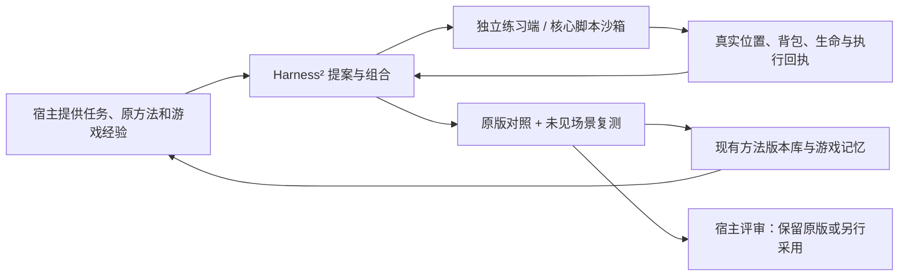

# Harness²：显式的游戏方法练习与经验积累

核心从 `0.5.7-rc.54` 提供 `Harness2Runner`（`agent-mc-world/decisions`）、`MethodPracticeExecutor`、`createPhysicsMethodPractice`、`createPracticeGameMemory`（`agent-mc-world/learning`）。导入不会连接游戏、请求模型、训练权重或采用技能。

集成使用 Google 原版 Harness² 的 Propose–Probe–Compose、并行/串行递归、选择和反思，固定到 [1cfe254e](https://github.com/google-research/harness2/tree/1cfe254e8d25b15f37048c3730134686abe60335)。这不是权重训练；改变的是有版本的动作程序、参数和使用说明。宿主仍然提供模型、人格、个人记忆及采用决策。



## 执行边界

- `PracticeExecutionPort.binding` 必须显式声明专用实例与 realm；不得与源 Agent 的实例或 realm 相同。绑定由宿主确认，不是远端世界身份的密码学证明。
- 同一 Runner 只运行一个任务，RPC 在宿主串行执行。上游并行生成方案不意味着同时向一个身体发动作。专用服务端需要实现自身的控制租约、确定性场景恢复、观测和清理确认。
- `MethodPracticeExecutor` 使用现有 `MethodRunner` 沙箱和 `MethodLibrary` 的语法校验、不可变版本、原执行 UUID、回执及复盘。宿主必须向 `host.call` 提供真实适配器，`settle` 必须确认原动作和按键已释放。`mineflayer` 调用沿用 `{value:...}` 返回封装。
- reset、执行或清理失联后，该执行端被阻断，任务写入 `blocked`。不能通过重开程序、删账本或新建 ID 来重放未决动作；先核对原执行及隔离实例。崩溃留下的 `run.lock` 也需先确认原进程/任务终态，不能按时间自动删除。
- 实际动作通过核心已有能力执行，不给予候选 shell、文件、网络或模型权限。仅允许修改三个文件：`skills/minecraft-method/scripts/run.js`、`params.json`、`../SKILL.md`。系统说明、工具声明、安全约束及召回记忆不可改；不得增加插件或子 Agent。

## 比较与采用

上游最终选择池只包含新方案。本集成另保留原版实测，并在模型没有见过的独立 fixture 上分别执行原版和选中方案。训练与复测 fixture 的 ID/snapshot 必须不同且环境版本一致。

首版目标支持到达指定位置、背包已知数量净增，附生命损失约束。独立采样位置/背包/生命，不相信程序自己返回的“成功”；缺失、过期、错实例、错 snapshot、未取得原执行 UUID或清理未知均不算成功。缺失物品键不是已知的零。

`gate.eligible=true` 只表示本组隔离对照至少一项成功率改善、原有成功项无退化且复测通过。未改善、证据不全或复测失败都保留原版。它不表示普遍提升或线上胜率，不证明战斗、生存、复杂任务拆解已学会。速度更快而成功结果相同，目前不会单凭耗时晋级。

`adopted` 始终为 `false`。`selectedReference` 指向练习作用域的方法版本，不能冒充源世界的方法引用。迁入源世界时需通过其现有方法库重新校验、保存，再按明确宿主策略审查原执行证据和 `expectedAdopted`；不覆盖运行中的程序，旧版及负例保留。

## Python 环境

上游使用 `fcntl`，需 Linux Python 3.12+；Windows 使用 WSL。显式安装可选依赖，不在游戏启动时自动安装：

```sh
uv venv --python 3.12 ~/.cache/mc-harness2/venv
uv pip install --python ~/.cache/mc-harness2/venv/bin/python -r /path/to/agent-mc-world/bridges/harness2/requirements.txt
~/.cache/mc-harness2/venv/bin/python /path/to/agent-mc-world/bridges/harness2/worker.py --check
```

不需要 `[render]`、OpenCode/Claude CLI、独立 API key。模型调用由宿主的 `model.generate` 处理。worker 校验安装版本及精确 Git 提交；editable 安装还检查跟踪源码未修改（兼容 Windows CRLF）。包内 worker 和 requirements 纳入构建哈希。

`worker` 显式设置 `command`、可选 `args`、可选 `script` 和 `workspace`。Linux 可使用独立 Python 绝对路径及默认 `harness2WorkerPath()`；WSL 的 command 为 `wsl`，args 为 `-d <发行版> --cd <Linux目录> --exec <Python路径>`，script 必须是 WSL 可读路径。没有 shell 插值。优先把 workspace 放在 Linux 本地文件系统，Windows 挂载盘会显著增加文件操作耗时。

## SDK 接入

`Harness2PracticeService` 从 `/learning` 提供显式后台入口。宿主注入原方法读取、当前身份、模型和隔离执行端后，`tool()` 返回可挂入 SDK/MCP 或 World 的公共 `mc_practice` 契约。`start` 需要原方法的精确版本，立即返回受理；`status` 只展开元数据，`result` 按需展开源码及原父版本。`cancel` 取消原任务，`close` 等待该任务退出；重启只读原账本，不恢复未决试跑。结果经过来源作用域校验。保存到源方法库、自然执行、复盘和采用仍走现有方法生命周期。

`parseHarness2ModelReply` 接受完整 JSON 制品；宿主必须提供能够返回完整源码的工具为空、仅游戏任务的后台模型通道。不要把短观察摘要接口用于代码编辑，也不要截断 JSON 或把完整私人会话交给优化器。取消信号应传回原模型请求。调用和缓存 token 没有回执时保持未知。

```js
import { Harness2Runner } from 'agent-mc-world/decisions';
import { createPhysicsMethodPractice, createPracticeGameMemory } from 'agent-mc-world/learning';

const practice = createPhysicsMethodPractice({
  directory: '/explicit/practice/methods', seeds: [1, 2],
  binding: { instanceId: 'lab-1', realm: 'practice', account: 'lab-bot', agent: 'my-agent', isolated: true },
});
// memoryPort.call routes to the host's EXISTING correctly scoped mc_memory tool.
const memory = createPracticeGameMemory(memoryPort);
const runner = new Harness2Runner({
  directory: '/explicit/practice/jobs', worker, model, practice: practice.executor,
  recall: memory.recall, remember: memory.remember,
});
const result = await runner.run({
  id: 'walk-revision-1', methodId: 'walk-method', sourceInstanceId: 'production-body',
  scope: { realm: 'production', account: 'my-account', agent: 'my-agent' },
  task: '游戏任务及公开 API 说明；仅放游戏资料', baseline,
  train: practice.fixtures[0], holdout: [practice.fixtures[1]], mode: 'parallel', k: 1,
  budget: { modelCalls: 6, trials: 6, wallMs: 180000, trialMs: 10000, contextBytes: 300000 },
}, abortSignal);
```

`baseline={code,params,guidance}` 应来自待改进的真实方法。`model={id, generate(request,signal)}` 返回结构化 `files`、匿名 `choice` 或 `experience:{cue,lesson,evidence,confidence}`；不能返回工具调用或以推理正文代替程序。`id` 应随模型路由/参数变化，宿主须遵守取消且不添加隐式重试。

自带 physics fixture 只有平地与碰撞物理，使用 Java 1.21.1 Prismarine、最多每次1000模拟 tick。`mc.state()` 返回 `snapshot.position` 与公开 `target`，支持 `bot.look`、`setControlState`、`clearControlStates`、`waitForTicks`；核心脚本仍有32调用上限。生命20、空背包是这个 fixture 的定义，不是从线上采到的数据。它不验证战斗、伤害、服务器规则、完整 Minecraft 场景复制或生产环境顺畅度。其他任务通过同一 `PracticeExecutionPort` 接入专用练习实例。

## 预算、账本与记忆

单模式常规需要 `4*k` 次练习、`3*k` 次提案/组合，`k>1` 多一次选择，另一次反思；每个留出场景增加原版与候选各一次执行。非法提案可能消耗更多预算。预算是模型调用数、执行次数、墙钟、单次方法时长及完整上下文 byte 数；不是 token 数或模型账单。超过上下文上限直接失败，不截断证据伪造完整输入。

任务 ID、完整配置、模型 ID、原方法、场景、作用域、召回经验及证据账本 UUID 共同绑定哈希。首次召回和账本 UUID 写入 `game-context.json`，恢复不重新召回而改变本次输入；另一份空账本不能误用之前的上游执行缓存。`journal.json` 保存次数、哈希、元数据、原执行及评审引用；重复 trial ID 返回原结果，已完成任务恢复不调用模型或身体，未完成任务不会自动续跑。更换配置用新任务 ID，并先处理原任务的未决效果。

`createPracticeGameMemory` 经现有 `mc_memory` 写入一次 `lesson`，标注隔离证据、原版对比和解释的限制，使用 jobHash 幂等检索。后续任务按需召回；不是无条件注入人格或扩大采用权限。记忆投递失败会保留 `memory:pending` 与完整结果，宿主可按 jobHash 显式重投 `memory.remember(result,signal)`，不得重跑练习来补记忆。上游 library 仅是当前任务的派生工作目录，可从方法/结果重建，不是新的权威记忆库。

元数据账本不记录宿主会话提示、回答、思考正文、聊天或凭据。独立工作目录会保存本次明确提供的游戏任务/召回经验、生成的方法源码/参数和结构化经验，这是可审查的方法产物，不是额外采集私人会话。不要把私人会话、角色资料或环境变量交给 model port。worker 不继承模型凭据。

## 只读实验可视化

`createHarness2Monitor({directory,jobs})` 从 `/decisions` 公开导出。传入明确允许展示的任务列表，复用一个 monitor 的 `snapshot()` 接入 `ClientConsolePort.experiments`，共享面板 `/#experiments` 显示过程和结果。每个宿主统一两秒采样，多个网页不增加文件读取；不会扫描目录、运行任务、调用模型或采用方法。

公开契约是 `agent-mc.experiments/v1`：阶段、调用与执行预算、输入/缓存/输出 token 与用量覆盖、实际试跑记录、基线/候选/留出观测、验证门槛及游戏记忆投递状态。只投影白名单元数据，不输出完整 journal、提示词、回答、思考正文、方法源码或凭据。缺失 token 保持 null，失败、未决效果与未达成目标分别显示。隔离试跑通过始终标注未在线采用。

运行账本五秒写入一次心跳，超过20秒没有更新的运行状态展示为未知，不能据此重放。在已完成记录里展示历史结果，不冒充当前运行状态。尚未开始的任务不伪造零用量。旧版没有 scope/心跳证据的 journal 保留为未知，不自动迁移或补跑。公开 projection 绑定已配置的 realm/account/agent 哈希。

默认面板禁止嵌入。宿主可显式允许精确的 loopback HTTP 或 `dsh-app://app` 桌面来源；CSP 仅放行该父页面，跨来源 API、控制 nonce、Host 与实例隔离检查保持启用。Java1.21.1 主维护，1.20.6 显式兼容构建。

## 验证与回退

默认单元测试不需要模型、Python或网络：`vitest run tests/harness2.test.ts`。设置 `HARNESS2_TEST_WORKER` 为 worker JSON 后，`tests/harness2-upstream.test.ts` 执行原版算法、实际物理、两个递归模式、反思及恢复检查，使用明确标记的确定性模型替身；它不证明真实 LLM 提升。

停用宿主的显式练习入口即可停止新任务；取消当前请求后仍须确认原清理终态。不要删除未知账本。源码回退用本提交的 `git revert`，包回退到先前锁定版本；线上采用始终另行操作，所以本集成没有替换当前线上方法或权重。
