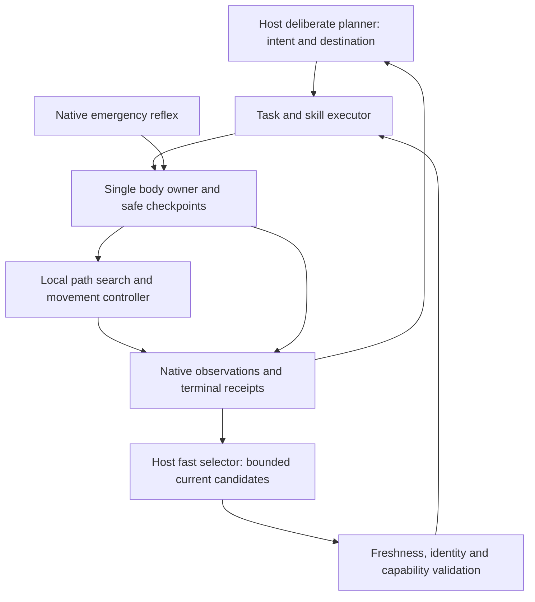

# Navigation, fast choices and deliberate planning

This describes the current shared core and the boundary between host decisions
and game execution. It does not introduce another model loop, a server-specific
route script or a new source of body ownership.

## Existing responsibilities

| Layer | Current entry point | Responsibility and limit |
| --- | --- | --- |
| Deliberate host planning (System 2) | SDK/MCP `mc_do`, `mc_goal`, `mc_script` | Choose the outcome, destination, stopover and resource budget; revise a failed plan from receipts. Host names may prefix these tools. Recording a goal does not execute it. |
| Host fast choice (System 1) | `mc_choose`, `HostCombatDriver` | Rank explicit candidates against bounded observations. `mc_choose` returns advice only; the combat driver dispatches a freshly revalidated candidate through the same game API. Model timeout leaves the native controller running. |
| Skill orchestration | `Executor`, `SkillContext.checkpoint` | Execute ordered steps, report terminal outcomes and preserve resumable work. `afterCheckpoint` suspends the old execution, runs an explicitly submitted detour, then resumes the original task ID. Container transactions and unknown effects cannot be blindly replayed. |
| Motion | `gotoGoalOnce`, pathfinder `Movements`, direct-control and swimming skills | Convert a selected movement into supported, collision-checked controls. Search failure, physical stall, lost control and relocation have separate receipts. A fast-model score is not a collision check. |
| Survival | `Reflexes`, environment hold tokens | React to observed immediate hazards without waiting for either model. Only the matching owner may release its hold; safe recovery does not necessarily make an old coordinate plan valid. |
| Presentation | Host chat and independent performance adapter | Read facts and speak while movement continues. Speech completion must not gate the next physical step. This layer cannot claim arrival from an accepted task. |

The current core already supports detours and interruption; it should not be
wrapped with a second independently moving agent. `core/travel.ts` owns path
identity; `core/executor.ts` owns task suspension/resumption;
`src/client/choice.ts` owns advice freshness; `src/decisions/combat-driver.ts`
owns the optional host inference lifecycle. Combat methods and scripts must
use those contracts, not issue competing native movement calls.

## Two integration defects exposed by replay

1. **Relocation during continuous follow.** A `goto` waits for a path result,
   while `follow` is a persistent loop. Clearing the path alone left `follow`
   waiting for an entity that could remain in the local cache. It now reports
   `navigation-location-changed` promptly, with the original task identity.
   The host can inspect the new landing and resolve the person again. It is
   not an arrival, and a nearby cached entity does not authorize replay.
2. **Progress without a new landmark.** The producer intentionally emits
   measured journey progress with an empty clue list. The consumer treated
   every journey ID as a landmark observation and rejected ordinary movement
   while inference ran. The optional typed `journeyReason` now distinguishes
   progress from clues. Legacy/missing evidence stays conservative. Task,
   position epoch, world, combat, support, inventory-window and age changes
   still invalidate the advice. No additional prompt text is required.

The native path invalidation itself was introduced in
[navigation-boundaries.md](navigation-boundaries.md). These follow-up changes
repair its integration with persistent skills and fast route advice.

## Applying navigation research to this architecture

The following are implementation directions, not claims that these algorithms
are installed:

- [D* Lite](https://idm-lab.org/bib/abstracts/Koen02e.html) reuses search work
  between related problems. Evaluate it inside the motion layer for local
  obstacle changes, not as a substitute for the host choosing a destination.
  Any retained graph needs explicit world/connection, terrain and movement-
  capability identity; a portal cannot reuse the previous coordinate frame.
- [Theta*](https://idm-lab.org/bib/abstracts/Koen10r.html) reduces grid heading
  constraints. Evaluate smoothing of supported walkable corridors before
  general any-angle search. Minecraft line of sight alone does not establish
  body clearance, safe support, a water exit or permission to dig/place.
- The [pathfinder movement API](https://github.com/PrismarineJS/mineflayer-pathfinder)
  already exposes composite goals, movement costs and search budgets. Keep
  per-search slices bounded so native physics, safety and speech are not
  starved. Do not increase a synchronous search timeout to hide stagnation.
- Portals, flight and server travel belong to a higher-level route choice.
  Compare verified prerequisites, destination identity, resource cost and
  actual landing receipts. A shortcut command is a skill with effects, not
  a free edge inferred from a place name. Reuse the existing capability
  catalog; the host chooses whether the shortcut fits the current intention.

## Acceptance before further algorithm changes

Use the same map, movement permissions and inventory for each comparison.
Cover flat detours, stairs/partial blocks, doors, water exits, unavailable
chunks, teleport, dynamic follow and a checkpoint meal. Separately record:
planning slice/expanded-node cost; first physical displacement; route length;
unexplained stationary intervals; dig/place/resource changes; terminal reason;
and whether the original task resumed exactly once. A faster model, accepted
task or shorter planned polyline does not prove a better executed route.

`navigation-boundary.test.ts` exercises native position application with local
physics. `navigation-checkpoints.test.ts` exercises actual pathfinder movement,
meal/detour insertion and host choice overlap. `choice.test.ts` checks current
advice versus teleport/combat/task changes. These are isolated protocol and
physics checks, not evidence of improved live combat or completed exploration.
