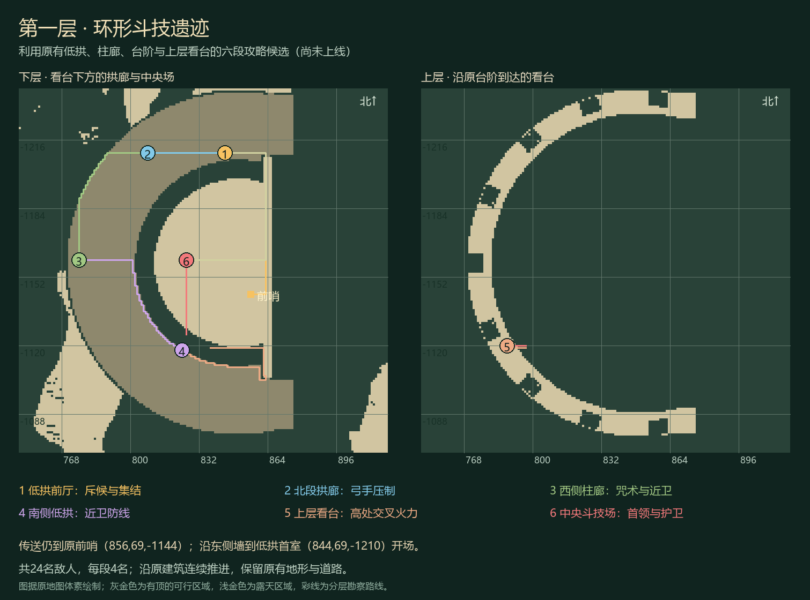

# 第一层·环形斗技遗迹

**状态：候选，尚未部署。** 正式服仍为 AF 0.4.47.34、三段攻略。新候选 AF 0.4.47.35 只扩展逐段路线说明与完整地板识别，搭配本页的六段地图配置；不能直接部署包含其他开发内容的完整 0.4.48 JAR。

## 为什么调整

原 `aincrad_01` 只有三个相邻露天刷怪点，后两段的敌人分别为三只和两只，几乎没有使用原建筑。新路线使用免费第一层地图已有的低拱、柱廊、上层看台和中央斗技场。四段有顶，两段利用看台高差与中央场，保留原建筑和地形。

这是依据 Minecraft 实际地图设计的首层挑战，不声称是原作逐室复刻，也不代表已取得或开放百层地图。原免费地图 SHA256 为 `0ddf2c3f8c767d2acdfa3be793293a47fd7cb3d45a34bb997ff9d5861970518f`。

## 六段路线

| 段落 | 实际坐标，世界均为 aincrad | 战斗与地形 |
| --- | --- | --- |
| 1 东侧低拱·前厅 | 844,69,-1210 | 看台下集结，四名斥候 |
| 2 北段拱廊·弓手阵线 | 808,69,-1210 | 三名持弓弓手、一名近卫，拱口和柱脚提供掩体 |
| 3 西侧柱廊·咒术守备 | 776,69,-1160 | 一名咒术师、三名近卫，注意毒与贴身敌人 |
| 4 南侧低拱·近卫防线 | 824,69,-1118 | 两名持斧近卫长、两名近卫，利用拱口控制接敌方向 |
| 5 上层看台·高处压制 | 788,78,-1120 | 三名弓手、一名近卫，沿原有石梯上楼 |
| 6 中央斗技场·伊尔芬格 | 826,69,-1160 | 320 生命领主和三名护卫，蓄力挥斩、远程追击、低血量换剑 |

每段四名，共二十四名；同一时间仅本段敌人活动。弓手戴铁盔，装备直接写在 MythicMobs 定义中，避免初始化把临时发放的弓、剑和斧清空。首领挥斩有 1.5 秒预告，需退出四格圈；低于 30% 生命后换剑。

前哨仍为 `(856,69,-1144)`，保持已有战备调查目标和传送点。开场改在低拱首室。南侧低拱先于上层看台，减少重复绕路；包含抵达和返程的勘察路线约 628 格，比初稿少 212 格。上楼经东南开口 `(862,69,-1119)`，由原石梯向西攀升；下楼经 `(825,72,-1120)`、`(826,70,-1128)` 到中央场。

## 玩家和 Agent 怎么用

先按 `/mycli dungeon info aincrad_01` 检查当前路线和战备。建议战斗 Lv.5、完整铁甲、职业武器、盾、食物和治疗；近战、弓弩、法器均沿原准入规则，不强制带剑。咒术师一段可准备解毒物资。

`/mycli dungeon travel aincrad_01` 仍消耗八魔力到前哨，沿东墙向北到低拱首室后，再 `/mycli dungeon start aincrad_01 normal`。队友按原十秒集结期加入。每段只需 `/mycli dungeon status aincrad_01`，短文本直接给当前路线；程序仍可显式 `--json` 读取 `guidance.routeHint`。没有新增顶层 CLI 命令。

完整清场后回**低拱首室**结算，再 `/mycli dungeon claim aincrad_01`，奖励进入远程个人箱 `/mycli arena stash`。原三十分钟时限、三次战败、组队救援、首领房间排他和领奖规则保持。

## 配置与兼容

- [地图与配怪](../config-candidates/aincrad-architecture-20261030/dungeons-overlay.yml)只替换 `sites.aincrad_01`，其余四个活动不改。
- [剧情说明](../config-candidates/aincrad-architecture-20261030/rpg-story-overlay.yml)只合并版本及原章节、原 NPC 话题的说明，保留所有条件和角色进度。
- [Vortex 任务目录](../config-candidates/vortex-native/quests.yml)只更新 `qd_floor_scout`、`qd_floor_clear` 的描述；任务 ID、前置、目标与奖励不变。
- [一次提醒](../config-candidates/aincrad-architecture-20261030/onboarding-overlay.yml)沿原账号私有、版本化通知，不重置首次登录记录，不向公屏发 JSON。
- 原已接受剧情仍保留冻结条件与历史文字；实时路线以 `dungeon info/status` 为准。旧三段通关记录保留，不改成六段通关，也不清除已完成成绩。
- 房间新增的提示文字不进入存档点规则签名；只改提示不会使旧场次失效。正式更换三段为六段必须等待全部活动结束，不能中途替换正在挑战的定义。

2026-10-30 只读观察到生产入口已指向 Youer 1.21.1 与原生女仆兼容层。本批不会把核心换回 Paper，也不替换模型、Numen、登录代理或其他插件。验证会分别保留 Paper 与当前 Youer 的结果。

## 验证与边界

Paper 隔离服初稿通过 49 项检查。最终精简路线在当前 Youer 核心、原生女仆模组和配套消息兼容层上通过 **54 项检查**：107 个安全刷怪点、普通生存客户端 82 个实际导航落点、Vortex 和剧情说明、默认短文本、实际射箭、换剑及六段参与后的保存通关。另有 207 项原回归和 9 项完整地板、半砖及历史签名检查。完整源码编译通过，正式候选只变化两个管理器 class 和版本元数据，其他 597 个 JAR 条目保持。

关卡机制测试会对一次性测试角色补血、对本段敌人注入原生伤害来快速验收阶段流转；路线部分使用普通生存客户端、碰撞和寻路，不挖方块、不搭柱。**机制通过不等于长期单人或多人战斗平衡已验收。** 上线后的真实通关时长、失败原因和职业表现仍需观察。

复现入口见 [地图实机探针](../probe/aincrad-architecture/README.md)。测试 JAR、私人世界、账号、日志和大地图不进入 Git。

MythicMobs 装备与触发格式参考其官方 [Equipment](https://wiki.mythiccraft.io/mythicmobs/mobs/equipment)、[Equip](https://wiki.mythiccraft.io/mythicmobs/skills/mechanics/equip) 和 [Skills](https://wiki.mythiccraft.io/mythicmobs/Skills/Skills)。历史地图双层台阶已转换为完整 `smooth_sandstone`；不能仅凭旧方块 ID 认定线上仍是半砖。
