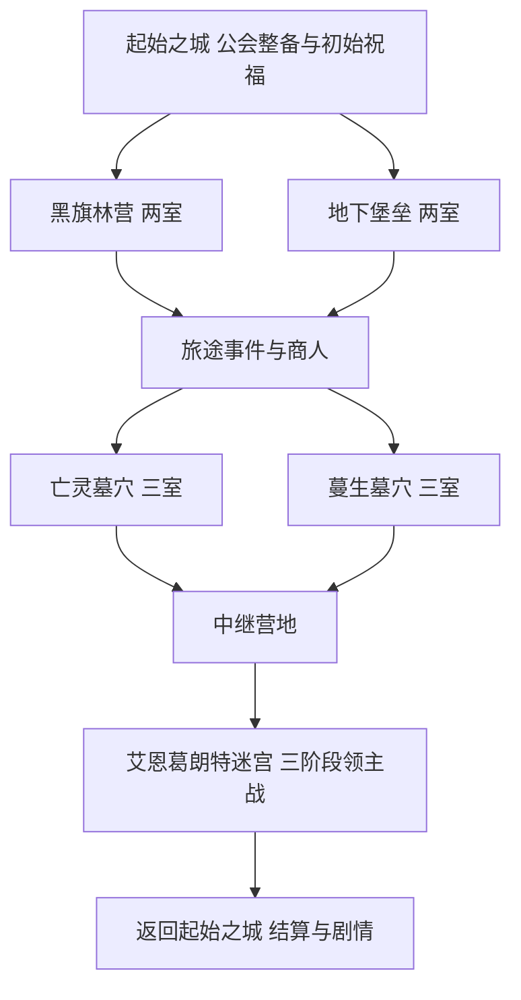

# 艾恩葛朗特与多遗迹肉鸽远征整合研究

日期：2026-11-08。状态：研究与设计补充，未安装候选插件或模组，未新增传送门或改变正式玩法。源码基线 `62679186`；本轮只读核对正式 AgentFriend 为 `0.4.47.62-entry-guide-rpg`。局内构筑与通用接口原则见[千灯秘塔设计](ROGUELIKE_TOWER_RESEARCH_20261108.md)。

建议以现有艾恩葛朗特起始之城承接公会、市场、整备和主线，把不同遗迹的一段挑战作为远征中的一层或一个区域，通过出口门串起多层路线。楼层进度由服务器场次记录统一维护；物理场景可分布在不同地点、专用副本区域或不同世界。

## 这次找到的参考

| 项目 | 已核实的机制或能力 | 对千灯纪的用途 |
| --- | --- | --- |
| Minecraft Dungeons 远古狩猎 | 程序化混合既有内容，投入影响遭遇，可跨多次游玩继续 | 用不同主题遗迹组成一条远征，钥石影响主题与风险 |
| Wynncraft Lootruns | 营地、信标选项、局内任务、祝福与诅咒 | 在 Minecraft 世界里做路线选择，给一局增加短期目标 |
| Hades | 房间出口预告奖励、祝福选择，以及据点角色和叙事的持续发展 | 门前就能判断下一处风险／收益；回城后延续剧情 |
| MythicDungeons | 私有副本复制、事件、条件与目标；另有程序化房间文档 | 优先评估能否承担副本实例与房间底层，接现有 MythicMobs |
| Dungeon Crawl | 随机地下遗迹布局、规模和战利品；存在 NeoForge 1.21.1 文件 | 后续在隔离内容世界生成并筛选新遗迹 |
| Dimensional Dungeons | 单独维度内生成可重复地下城、门户、房间与机关；存在 NeoForge 1.21.1 文件 | 评估门户和房间素材，但需适配新增钥匙及门户内容 |

远古狩猎的开发者明确把「继续利用已有内容」「消耗过剩资源」「让玩家影响任务」作为目标；生成后的任务可分多次游玩。这与本服已有遗迹、物资积累和 Agent 续局需求吻合。[官方开发日志](https://www.minecraft.net/en-us/article/dungeons-dev-blog---adjusting-endgame)

Wynncraft 的官方 2.0.4 说明介绍了三选一局内任务、额外信标选择、祝福和诅咒调整。这里借鉴其选择与短任务机制，不照搬具体数值或实时限时制度。[官方更新说明](https://forums.wynncraft.com/threads/2-0-4-full-changelog-new-bank-lootruns-more.310535/)

Hades 的开发者说明包含多出口、出口奖励预告和持续的角色叙事。可据此设计有不同主题标识的门，让选择发生在看得懂的场景中。[官方设计更新记录](https://www.supergiantgames.com/blog/hades-welcome-to-hell-update-patch-notes/)

### 现成组件的使用判断

现役已安装 MythicMobs 5.9.5、FastAsyncWorldEdit 2.16.1 和 Multiverse-Core 5.8.1；本次检查未见 MythicDungeons。怪物、首领技能和已有建筑处理已有基础，新开发应集中在远征编排、选择、遗物与统一结算。

MythicDungeons 的[实例说明](https://wiki.mythiccraft.io/mythicdungeons/How-it-Works)描述了私有副本复制；其[程序化文档](https://wiki.mythiccraft.io/mythicdungeons/Procedural-Dungeons)仍明确标注仅适用于2.0开发构建。不能把文档中的生成器能力当成任意稳定包都已具备。[免费版说明](https://wiki.mythiccraft.io/mythicdungeons/Free-Version-Differences)也提示需以实际下载构建核对限制。先对选定版本做 Youer 1.21.1、MythicMobs、队伍、卸载与正常重启测试，再决定复用范围。

内容模组已经核实到具体候选：[Dungeon Crawl 2.3.17 的 NeoForge 1.21.1 文件](https://www.curseforge.com/minecraft/mc-mods/dungeon-crawl/files/7887320)、[Dimensional Dungeons 的1.21.1 NeoForge发行项](https://www.curseforge.com/minecraft/mc-mods/dimensional-dungeons)。它们的存在证明有对应版本文件，尚不代表已通过 Youer、Geyser或原版 Mineflayer 验收。Dimensional Dungeons 的房间使用原版建筑元素，但模组本身仍新增少量物品与方块，需要单独检查交互。

## 现有地图和素材盘点

现有免费地图提供艾恩葛朗特第一层场景，适合承担起始之城、野外与首层攻略。后续攻略层可以用新主题遗迹和营地逐批扩展，不把已有第一层描述成已经开放的百层地图。

本轮从正式 `plugins/AgentFriend/dungeons.yml` 只读取得 **5处挑战场地、13个房间**：

| ID | 现役世界 | 房间 | 首室配置中心 | 适合提取的主题 |
| --- | --- | ---: | --- | --- |
| `illager_camp` | `world` | 2 | `(-1077,67,-1117)` | 林地哨站、营火、截击与情报 |
| `bunker` | `world` | 2 | `(-1182,18,-1547)` | 堡垒、弩手、掩体与交叉火力 |
| `undead_crypt` | `world` | 3 | `(-425,4,677)` | 墓穴、封印与亡灵 |
| `creeping_crypt` | `world` | 3 | `(1159,45,209)` | 蔓生地宫、女巫与毒素 |
| `aincrad_01` | `aincrad` | 3 | `(856,69,-1144)` | 前哨、迷宫守卫与狗头人领主 |

表中坐标是配置中的房间中心，用于定位素材；新实例的传送落点须核对地板、碰撞、净空、世界与保护。原[六段建筑扩展](AINCRAD_ARCHITECTURE_20261030.md)仍是另一份候选说明，本次现场配置是三阶段，不能把两者混为已部署内容。

起始之城现有返回门位于 `aincrad (-583,67,919)`，对端主世界门位于 `world (-563,67,-443)`。新远征入口宜设在城内公会或攻略广场的明确位置，沿用主动确认的交互原则。玩家路过、Agent寻路或箭矢／红石触发不能直接报名或切换场景。已有双城门规则见[主动按钮传送](CITY_GATE_BUTTONS_20261103.md)。

## 地图如何组成多层

将三个概念分别显示：

- **世界主线攻略层**：某个已发布章节的长期通关记录与解锁。
- **本次远征节点**：本局第几处挑战、事件或整备节点。
- **物理世界与位置**：实际所在世界及绝对坐标。

这样「远征第8节点」不会被误读为已经完成艾恩葛朗特第8层；换到另一个世界也不会沿用上一处坐标。

第一幕可以从现有素材组合出如下路线：

一条示例共12个经过节点：初始祝福1个＋林营或堡垒2室＋事件1个＋商人1个＋墓穴或蔓生地宫3室＋中继营地1个＋迷宫3阶段。墓穴末室和最终领主承担两次首领节奏。具体组合、首领强度和总耗时仍需实战调平。

同一遗迹内部保留步行、楼梯、掩体与高差；跨遗迹通过出口门转换。出口显示下一处主题、挑战类型与奖励类别。需要分叉时作一次明确选择；全队就绪后倒计时出发，单一路径可在清场与个人选择完成后自动继续。

后续新攻略层以章节发布，配置自己的据点、主题遗迹、领主和解锁条件。地图可以来自现有风格的专用模板、新制作场景或隔离生成的合适遗迹。先逐层提供完整游玩闭环，再扩大层数。

## 每局变化放在哪里

1. **路线变化**：林营或堡垒、亡灵或蔓生，今后加入雪地、水下与火山主题；同局控制重复。
2. **遗物构筑**：每次真实战斗后的三选一，继续使用六槽位和明确的触发／叠加上限，影响既有技能与武器打法。
3. **钥石与词缀**：玩家可选择偏好的主题与公开风险。例如弩手增援、精英守备、机关增多对应不同奖励预算；钥石只影响规定范围，不直接点选最终稀有物品。
4. **局内委托**：清场之外加入激活封印、救援NPC、寻找钥匙、护送与有限采集。完成后给本局优势或限额结算加成。
5. **事件与撤离**：献祭少量明确资源换祝福、带诅咒领取宝库、帮旅人换商店折扣，或在营地结束本局。代价与失败条件在确认前说明。
6. **回城剧情**：公会和NPC根据真实通关、救援及捐赠记录增加对话和后续委托。新剧情由运营团队发布内容定义，当前场次保持冻结规则。

钥石可用原版纸或紫水晶碎片承载中文名称与受验证的专用数据；默认不要求玩家祭献已有装备。若提供物资换钥石，复用已有报价／确认流程，列出完整物品及实际消费，保护绑定、任务、唯一与已装备物品。

新目标应先实现清场和机关互动，再扩展护送、采集。每种目标都要有服务端可核对的完成条件；NPC卡住、物品状态未知或机关未实际生效时不能靠聊天自报完成。

## 场地与编排的实现边界

现有 `SiteDungeonManager` 的一个地点对应一个世界与一段房间顺序，加载器最多接受16个地点。不同世界的遗迹不能只往同一地点的房间列表追加坐标。需要一个远征编排层引用各节点的场景、目标与实例，统一管理队伍、局内构筑和本局结算。

推荐使用审核过的遗迹模板副本组成专用远征场地。模板明确几何、怪物点、可交互机关和战利品定义；不直接复制活跃世界中的玩家物品、掉落物、商人仓库或装满物资的容器。原公共遗迹的挑战身份与奖励不作为新远征的可重复结算捷径。

场地底层优先评估成熟实例插件与已有世界／编辑工具。Vortex继续管理职业、技能、魔力和永久金币；MythicMobs处理受控怪物与首领；新编排层负责节点、选项、局内修正和统一回执。各层之间应共享真实事件与身份，不各自生成一套奖励或参战记录。

跨遗迹转换需成为同一远征里的正式状态迁移：

1. 确认当前节点已完成、路线选择有效、下一场地可用；固定目标世界、实例和安全落点。
2. 保存转换意图、原检查点、队伍与请求标识，进入 `transitioning`；此时不提前生成下一轮敌人或结算新奖励。
3. 通过合法的场次内部传送迁移合格队员，逐人读取实际世界与落点；部分到达就返回部分状态，不能宣布整队已到。
4. 全队达到开战条件后启用新节点。离线成员保留待到达状态，重连按原场次处理；倒地、退出和观战者按各自身份处理。
5. 目标忙、区块不可用、保护拒绝或结果未知时保留明确原因与续接入口，不重复扣费、重新抽路或任意传送到其他坐标。

普通对外传送命令仍由原权限、战斗和安全规则判定。内部转换不能靠关闭保护、授予OP或把通用传送限制放开来实现。已有 `DungeonArrival` 到达证据、检查点与回执思路可复用，实际接入时按所选实例API核验。

永久主线证明、日限奖励和本局节点奖励分开：普通远征房间清场不自动伪造成原正式层通关或原遗迹完整攻略。正式章节的完成事件只有在相应完整条件满足时才登记。

## 多端与性能要求

- 真人和基岩用明确的按钮／原版菜单确认路线，门口有中文主题与费用提示。新模式不依赖客户端专用GUI才能完成主流程。
- Agent按需取得当前节点、合法出口、选项、目标、世界和绝对坐标；地图信息与真人可知内容一致，不提前给出未揭示怪物坐标或箱内物品。
- 继续通过当前账号连接单播状态；界面、CLI与实际战斗使用同一数值和规则。维持现有消息预算、请求去重、未知结果对账及正常游戏失败语义。
- 只加载当前节点及确认后的下一处所需区块；模板预先制作和校验，不在服务器tick里临时生成一整片世界。
- 初版单队1–4人验证完整流程；扩展并发时有实例占用与队伍隔离。怪物、飞行物、粒子和区块票据按全服预算核算。
- 模组候选先在隔离环境验证注册表、物品／方块身份、菜单、真实交互与基岩表现；只有对应版本文件不算兼容验收。

## 建议推进顺序

1. 用已配置场地的审核模板做「起始之城→两室主题→三室主题→迷宫领主→回城」的隔离路线，先测整队转换、绝对坐标、退出重连与一次结算。
2. 接三选一、局内遗物、营地和两个简单事件，验证真实技能效果、资源消费与原职业数据保持。
3. 由真人、基岩和不同接入的Agent完成自主流程；分别记录通关率、耗时、决策轮次、无效调用、卡点及掉线恢复。
4. 评估选定 MythicDungeons 构建以及内容模组，按实际收益决定是否引入更多实例或遗迹生成能力，再扩展下一攻略章节。

本次交付为研究与可实施的整合顺序，未将上述新命令、路线或内容当作已开放。后续配置、资产导入与运行发布分别记录。
