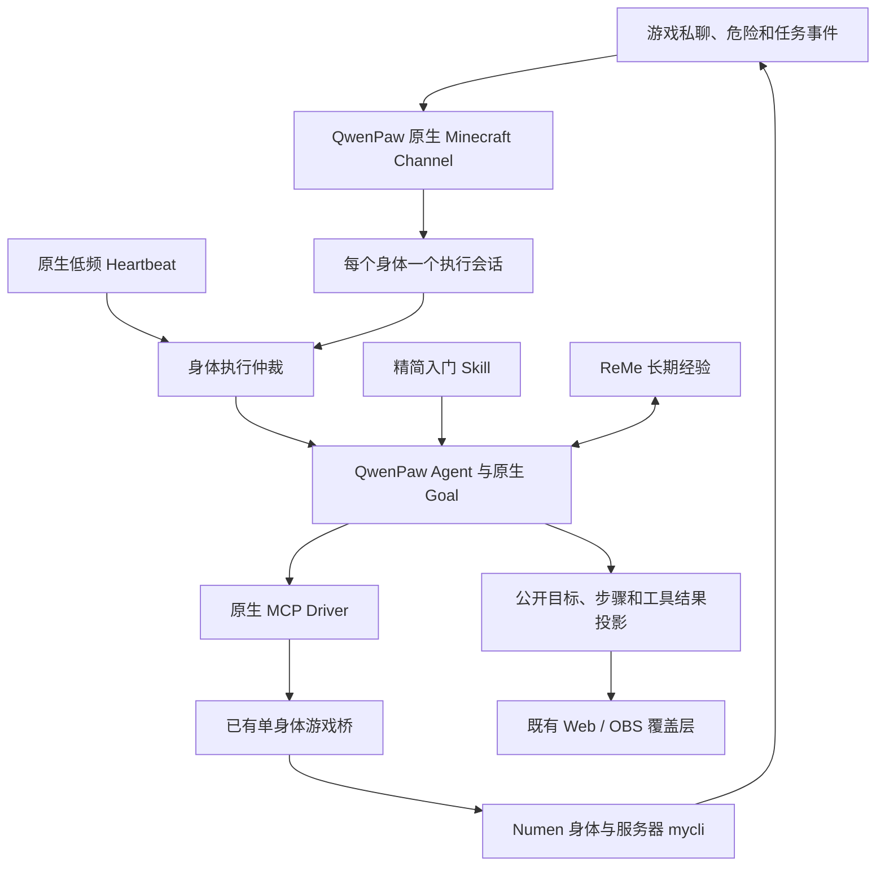

# QwenPaw 与千灯纪的原生能力结合方案

**后续进展：** 原生频道、入门Skill、Goal、ReMe持久化/新进程搜索和心跳候选已完成实现及隔离验证，尚未切换正式桐人。当前结果和边界见 [原生游戏接入](QWENPAW_NATIVE_GAME.md)。下文保留启用前研究记录。

2026-10-20。基于本机 QwenPaw 2.2.2 源码、桐人实际配置、原生记忆状态接口和官方 v2.2.2 资料。**研究与接口核验已完成；本方案尚未安装或启用。** 正式桐人保持原有在线控制，未重启服务、修改玩家物品或启用其他 Agent。

## 一、修正两项先前判断

### Plan Mode 当前不可用

`plan.enabled=false` 只是配置现状。直接执行本机 `CommandHandler._process_plan`，实际返回 `temporarily unavailable`；官方 v2.2.2 同样保留迁移占位实现。不能把改为 true 当作获得规划能力，也不应按旧 PlanNotebook 接口开发。

当前确实存在原生 **Goal Mode**，提供 `create_goal / get_goal / update_goal` 和预算、停止门。可先用它承载一个明确获准的短目标；完整游戏目标执行仍需联机验证。`Mission Mode` 已存在，但不等于已经适合游戏任务，先不引入其项目文件、重试和验证流程。

### 自动沉淀与自动检索是两件事

原生 `GET /api/agents/mc-kirito/memory/runtime-status` 实际返回：

| 项目 | 当前读数 |
| --- | --- |
| 自动沉淀 | enabled=true，interval=5 |
| 记忆工作线程 | idle，等待0，运行0 |
| 最近错误 | 无 |
| 自动检索配置 | enabled=false，最多2条 |
| 手动 memory_search | 已配置开放 |

这里的 **5 是外部对话回合数，不是分钟数**。中间件积累同一会话的用户轮标记，达到门槛才提交记忆任务。先前测试多用独立会话，暂未形成长期笔记不能据此认定记忆服务损坏。

原生中间件还会跳过 `heartbeat`、`cron` 等自动化来源的自动检索与沉淀。仅打开心跳，不能保证它自动记住和召回游戏经历。

## 二、建议的职责分配

QwenPaw 承担决策、上下文、会话、记忆和目标停止。Numen 提供身体与游戏动作，Paper 判定任务、技能消耗和权限。自定义部分集中在游戏传输、动作结果核对、角色执行互斥及公开状态投影。

三类状态要明确：

| 状态 | 权威来源 | 用途 |
| --- | --- | --- |
| 当前背包、血量、冷却、任务和保护范围 | 服务器实时回执 | 决定当前能否行动、是否完成 |
| 当前目标、步骤、等待条件 | 原生 Goal + Numen todo | 延续一个行动目标；不能代表服务器已经验收 |
| 人际关系、路线经验、失败教训、生活故事 | QwenPaw ReMe | 帮助回忆和选择；涉及当前状态时重新查询 |

## 三、原生 Skill：先解决入门与上下文成本

先提供一个 `qiandengji-start`，建议正文不超过600个中文字符，`preload=true`。内容只包括：

- `/mycli help`、`/mycli status`、`/mycli tasks status` 的入口和下一步读法。
- 技能以 `/mycli skills status`、分页列表、单项详情为准，不反复读取33383字符的整表。
- 保护拒绝按 `nextCommand` 处理，未知结果先查询；原版私聊回复真实用户名。
- 公会门口公共补给、大背包、个人奖励箱是三个不同用途。

具体职业技能、委托、地形和故事仍到游戏里学习。MCP 的 `skill` 工具查询 Numen API；它和 QwenPaw 工作区 Skill 分别命名说明。

本机原生构建器支持预加载 Skill 正文，因此第一阶段可以继续关闭宿主机文件工具。手动放入文件会被登记为禁用，需要通过工作区技能管理启用，并核对 MCP 依赖名 `kirito-world`。以后可再把实测成功的救援、交易、探索等流程存为按需 Skill，不把所有内容预加载。

**验收：** 原生有效 Skill 清单能查到；构建后的提示含短说明；新会话能找到规则与任务；记录上下文体积，不以“文件存在”代替加载成功。

## 四、原生频道与统一执行会话

### 接入方式

使用 `PluginApi.register_channel` 注册 `BaseChannel` 子类，复用原生 Channel Manager、队列和回复流程。配置只落在 `mc-kirito`，游戏凭据继续引用受保护文件。官方样例有旧版本范围，不能照抄 `max=2.1.0`；候选先锁定实测的2.2.2。

第一版保留现有单实例 MCP driver 和 Brain 凭据。原生频道通过既有 driver 的受控调用获取事件，**不另开第二个 Brain 连接或收件箱消费者**。具体 driver 生命周期与调用 ABI 必须在候选插件里验证，不能将其当成已接通。

迁移时由开关决定事件归属：旧 `dispatch_events` 和新 Channel 只启用一个。现在稳定的 Console 路径保留作回退。

### 角色执行互斥

原生队列的键是 `(channel_id, session_id, priority_level)`。它只串行处理相同键，其他会话或优先级仍可能并发。现有 MCP 动作锁也只保护一次工具调用，不能保证多个目标不交错争用同一身体。

因此：

1. 每个身体使用一个稳定执行会话和固定普通优先级。不同私聊对象保留独立回复目标，不另起并行身体控制。
2. 收集私聊时保留真实发送者 UUID、用户名、来向和事件ID；回复由原生频道路由一次，避免模型工具和频道各发一次。
3. 查询回执和高频位置变化进入有界状态缓存；实际私聊、危险、任务结束等事件才触发决策。
4. 原生命令如 `/goal` 由可信控制入口激活。游戏聊天原文作为消息内容，不直接执行框架控制命令。
5. 紧急停止要调用原生取消机制，随后查询身体任务和库存。取消与超时都不能据此自动重做动作。

**验收：** 两人同时私聊、私聊与心跳同时到达、活动优先级变化、重复事件和重连；始终一个身体控制回合，私聊不串人，无重复消耗。

## 五、目标执行复用原生 Goal

先选一个附近、有限、可核验的目标，例如“查看当前委托、检查装备与公共补给位置并汇报缺项”。由服主或已授权控制入口明确启动，先设置较小轮数和 token 预算；数值通过实测调整，不使用无限循环。

原生 Goal 管目标与停止，Numen todo 记录身体行动阶段。每段都包含目标条件、实际回执、等待状态和下一步；任务完成仍以服务器对应任务ID与进度为准。`update_goal(complete)` 本身不能发奖励或代替服务器交付。

耗魔、领取、存取和交易超时进入“结果未知→只读复核”，不能由目标循环自动重放。断线恢复先读服务器状态与原生目标，再决定是否继续。真实困难或预算耗尽都如实停止，不将停止伪装成已完成。

**验收：** 正常完成、冷却等待、保护拒绝、未知结果、断线与预算结束；核对动作次数、物品总量和目标状态。

## 六、ReMe 记忆接入

按“保存成功→能查回→按预算自动召回”的顺序验证：

1. 用专用验证会话和无敏感信息的记忆标记，验证原生沉淀及 `memory_search`。不向正式游戏会话填虚构经历。
2. 生产事件保留稳定会话，避免每轮换ID。测试与生产来源分开，已有测试记录保留并明确标注，不直接把它们沉淀为真实游戏经验。
3. 确认记忆文件及来源链后，评估最多2条的自动检索；记录实际召回字节、模型 token 和耗时。不能仅因配置保存成功就声称已召回。
4. 心跳自动来源会跳过相关中间件。需要过去经验时，心跳任务显式使用原生记忆搜索；生产事件经过普通频道生命周期形成经验。
5. 学到的坐标和规则携带世界/维度、来源与适用时间。当前任务、冷却和库存每次重新查询；保留失败教训，而不复制大段动态JSON。

“写日记、拍照留念和书籍展览”仍是游戏行为，可把作品ID、标题和公开故事作为记忆来源，照片字节由既有游戏档案保存。原始私聊和私人资料不直接投影到公屏或 OBS。

## 七、主动生活与心跳

原生 Heartbeat 可以定期检查饥饿、背包与当前目标。建议候选从10分钟一次开始，每次最多推进一个短阶段；具体频率通过延迟和 token 记录决定。

本机心跳请求默认使用 `main` 会话。`target=last` 控制回复投递位置，**不会把执行会话改成当前游戏会话**。因此不能现在直接开启，然后宣称它和游戏事件已统一串行；要先经过身体执行仲裁，或在第一阶段只做状态检查。

只在无人操作、连接正常、没有进行中的身体任务时考虑一个自主目标；已有目标优先继续，没有有用动作就安静待机。定时对话、自动研究论文或宿主机 `/proactive` 监视不是游戏生活的前提，保持与游戏无关的工作关闭。

**验收：** 目标继续、无事可做、断线、危险及玩家插话；无重复计划、无额外公屏通知，原目标不会被另一个心跳会话覆盖。

## 八、Web / OBS 复用原生事件与现有渲染

通过 `register_middleware` 的 `on_acting` 等原生钩子产生有界公开状态：简短意图、当前步骤、工具开始/结果、等待原因、确认过的位置和操作类别。工具已发出与动作已完成分别显示。

既有可视化已提供 `getAgentStatus` 注入、Agent状态、路径/轨迹、marker及OBS编辑能力。消费者接入公开投影即可，初期不改渲染器。`chat.toolRender` / 自定义卡片可用于 QwenPaw 自己的控制台；它们不会自动出现在独立的 Minecraft Web 页面。

- 复用现有连接与观察者数据链，绑定身体 UUID、维度和会话代次，不新增公网接口。
- 实际移动轨迹来自真实位置；候选路径只有在游戏路径接口确实提供数据时才绘制，不从工具名编造路径。
- 保留现有FOV/相机投影和各类动作配色；没有新的世界坐标数据时不重复生成点线面。
- 只输出面向观众的意图摘要和结果；不导出原始提示、私有记忆、凭据或模型内部推理日志。

如果后续需要改变共享渲染器，改动提交 `jcs130/mc-visual-console`；此次只是核对现有接口，没有修改或部署该仓库。

## 九、分阶段落地与多 Agent

| 阶段 | 工作 | 上线前需要证明 |
| --- | --- | --- |
| 1 | 精简预加载 Skill、记忆写入/搜索验证 | 真实加载、来源可查、短上下文；不改游戏权限 |
| 2 | 原生游戏频道、统一执行会话与回复 | 只保留一个事件入口和身体控制者，私聊正确，无动作重放 |
| 3 | 有预算的原生 Goal、低频心跳 | 完成/等待/中断明确，心跳不争用身体 |
| 4 | 公开状态投影到现有 Web / OBS | 数据绑定正确，画面分类与实际动作相符 |
| 5 | 扩展到16个独立角色 | 共用Skill池，各自工作区/记忆/凭据；验证整体模型与游戏负载 |

每个 Agent 并发1、每分钟12次不是全体16个的总限额。扩大前记录全体模型并发、tokens、回合等待、游戏动作队列、TPS/MSPT和未知结果数量；重用框架限流与服务器现有限额。通过少量角色逐级验证后再扩容，不将16条连接成功当作16个自主 Agent 稳定。

本研究没有执行上述启用步骤。现有桐人仍使用已上线版本；候选按插件和工作区配置分别验证，正式切换前确认各自生命周期。Paper 是否需要重启，以实际产物是否涉及服务端插件为准，不用研究方案触发维护。

## 十、证据与源码入口

只读/离线8项核验通过，0次模型调用、0次游戏动作；正式角色配置、提示、MCP driver与游戏桥摘要保持一致。包括实际 `/plan` 返回、心跳间隔解析、频道/中间件注册接口、Goal命令声明、自动化来源排除、Skill预加载选择器及记忆状态GET。接口存在不是完整联机玩法验收。

本机证据：`E:/MC/ops/repairs/qwenpaw-game-integration-research-20261020/`。源码基目录为 `D:/qwenpaw/home/venv/Lib/site-packages/qwenpaw/`：

| 入口 | 核对内容 |
| --- | --- |
| `agents/command_handler.py::_process_plan` | Plan占位返回 |
| `modes/goal/goal_mode.py`、`tools.py` | 原生目标、预算与工具 |
| `plugins/api.py::register_channel/register_middleware` | 原生扩展接口 |
| `app/channels/unified_queue_manager.py` | 按频道、会话、优先级分队列 |
| `app/crons/heartbeat.py::run_heartbeat_once` | 心跳默认main与回复路由 |
| `agents/middlewares.py::MemoryMiddleware` | 按用户轮触发、自动化来源排除 |
| `agents/memory/reme_light_memory_manager.py` | 原生沉淀/检索实现 |
| `runtime/builder.py`、`prompt_contributors.py` | Skill加载与预加载 |
| `app/routers/agents.py` | 单Agent记忆运行状态 |

官方交叉核对：[v2.2.2命令实现](https://github.com/agentscope-ai/QwenPaw/blob/v2.2.2/src/qwenpaw/agents/command_handler.py)、[插件文档与频道扩展](https://github.com/agentscope-ai/QwenPaw/blob/v2.2.2/website/public/docs/plugins.zh.md)、[心跳](https://qwenpaw.agentscope.io/docs/heartbeat/)、[记忆](https://qwenpaw.agentscope.io/docs/memory/)。主站可能随新版变化；本次结论以本机固定版本的源码与实际读数为准。
