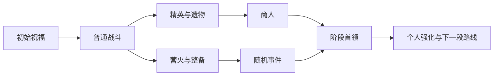

# 千灯秘塔玩法研究与首版设计

日期：2026-11-08。状态：研究与待实现设计，没有新增正式玩法、命令或发布任务。代码核对基线为主干 `86c79063af94c8365a55940df5022a6d41c9d0e6`，现役 AgentFriend 为 `0.4.47.61-market-cli-rpg`。

建议在千灯纪增加「千灯秘塔」远征入口：实时战斗、分叉路线、局内构筑、随机事件与首领战结合。每一局让玩家决定承担什么风险、选择哪些能力组合，以及什么时候补给或撤出。已有试炼塔继续承担固定层数挑战；新模式拥有独立场次与局内状态。

艾恩葛朗特地图、多遗迹传送、现役场地核对及可复用项目的后续研究见[地图与多遗迹整合](AINCRAD_RUIN_EXPEDITIONS_20261108.md)。该补充以较新的运行版本与配置为准。

## 借鉴什么

《杀戮尖塔》的官方介绍强调每局变化的路线、逐步形成的卡组以及遗物之间的协同。这提示千灯纪应把成长选择贯穿整场远征：一次选择影响后面几个房间，而不是只在通关后多抽一件装备。[官方游戏介绍](https://store.steampowered.com/app/646570/Slay_the_Spire/)

开发者 Anthony Giovannetti 在 GDC 的分享强调：让每个选项有适用场景，结合数据、玩家反馈和持续迭代调平，同时把数据当作证据而非直接结论。我们需要记录选择与实际结果，不能只因为一个遗物使用率高就认定它过强。[开发者的设计与平衡分享](https://media.gdcvault.com/gdc2019/presentations/Giovannetti_Anthony_SlayTheSpire.pdf)

《我的世界：地下城》的塔提供了更接近 Minecraft 战斗的参考：轮换主题、怪物与首领组合，以及高差、陷阱、机关等地形挑战；设计师也强调平滑的难度曲线。[官方塔轮换与关卡设计访谈](https://www.minecraft.net/en-us/article/dungeons--new-tower-rotations)

| 参考机制 | 千灯纪的设计 | 玩家要作出的决定 |
| --- | --- | --- |
| 分叉路线 | 普通战斗、精英、事件、营火、商人、宝库与首领节点 | 根据当前构筑与补给选择路线 |
| 战后卡牌选择 | 战后从三种局内强化中选一，也可放弃或选择明确标价的替代补给 | 补短板、强化主流派，还是留资源 |
| 遗物协同 | 六个局内遗物槽，组合已有职业、技能与装备效果 | 有限槽位中形成配合，而非无限堆加成 |
| 营火与升级 | 补充远征灯火、强化一项遗物或净化一种诅咒 | 维持续航还是争取后期强度 |
| 风险事件 | 明示代价及可知风险的祭坛、救援、交易与机关 | 为更好的未来收益承担当前代价 |
| 敌人意图 | 首领重击、冲锋、范围法术提前显示读条与真实危险范围 | 闪避、打断、掩护或爆发 |
| 每日挑战 | 相同内容版本与种子的挑战，配套完整战报 | 练习路线与比较策略 |

这些是千灯纪的改编设计；上表不代表当前服务器已经具有这些机制。

## 首版范围

首版以一幕 **12 个经过节点**、两个首领、20 种遗物、六种事件为内容目标。支持单人或 1–4 人队伍，先开放一个独立远征场地。单局 25–40 分钟是需要实战验证的节奏目标。

- 第一节点介绍本局规则并给予一次初始祝福选择；分叉处展示 2–3 个合法下一去处，连续房间按已选路线推进。
- 首领位于每段主题路线末尾，最终节点为收官首领；具体节点编号根据所选遗迹确定，首领前提供整备机会。
- 战斗节点、精英节点、事件与商人节点使用预先验证的房间模板。模板池可在后续运营中扩大。
- 战斗结束自动打开个人强化选择；选择与队伍路线确认完成后，倒计时进入下一房间。纯战斗转换不要求反复找楼层按钮。
- 路线属于全队选择，个人强化由本人选择。多人投票规则、队长权限和弃权方式必须在进入前明示；平票按公布规则处理。
- 等待选择时保留待选状态。不得为了超时自动替玩家选遗物、花钱或献祭资源；Agent 的模型响应延迟不能被当作一次错误选择。

下面是一段路线示例，并非已经生成的正式场景：



## 让构筑确实改变玩法

每人最多装配六种局内遗物。相同遗物能否升级、最高等级、互斥组与触发上限均由定义明确。每个选择都应说明：触发条件、作用对象、准确效果、上限、代价、组合标签与有效范围。

示例流派：

| 流派 | 初始方向 | 可组合的遗物设计 |
| --- | --- | --- |
| 冰霜控场 | 现有霜环、冰系能力或寒霜装备 | 霜裂晶核：对本局冰霜技能有效减速的敌人获得额外伤害；寒潮回收：击败这类敌人返还少量统一魔力 |
| 星芒连击 | 星芒箭与远程输出 | 回响符文：若干次有效施法后产生一次弱化追击；追击不再次触发自身或重复计算施法熟练度 |
| 炎纹近战 | 火焰能力、斧与近战武器 | 灰烬印记与受限传播，侧重位置和群怪；不让伤害无限递归 |
| 守护反击 | 盾、防御与队友支援 | 护盾、格挡后反击、有效救援后的本房间增益；避免靠友伤或反复进出房间刷新 |

这些遗物名称和效果是设计示例，数值与对应原生技能 ID 待实现时按实际技能目录确认。初版优先做可组合、易解释的效果，避免把大量几乎相同的百分比加成塞入奖励池。

局内遗物宜保存为场次记录，菜单使用原版物品作选项图标。它们不是背包里能取出的战利品；接口应明确 `kind=choice` 与 `scope=run`，避免 Agent 再把菜单图标当作待领取物品。

## 资源取舍与治疗

Minecraft 的食物、自然恢复、治疗技能和脱战光环使生命值有可能在房间间恢复。直接照搬「营火回血」可能使营火长期没有选择价值。

建议首版采用全队共享的「远征灯火／补给」作为不会自然恢复的局内资源：按完成节点、倒地和特定事件消耗，在营火或通过有限补给补充。它不按模型思考、网络等待的墙钟时间扣除。消耗、补充量与失败条件须在入场时明示并经实战调平。

营火提供「补充灯火／强化遗物／净化诅咒」等互斥选择；已有治疗技能仍有战斗用途。这样可以先形成路线与资源决策，再评估是否需要专门的伤势机制。

局内商店使用独立的远征币，按本局规则获得和消费；永久金币仍由既有 Vortex/Vault 银行管理。临时货物及余额不直接兑换成永久财富，结算奖励按明确的通关与参与规则产生。

## 房间、怪物与首领

模板需要包含入口、出口、可达路径、玩家集合点、敌人生成点、掩体、高差和危险区域。每房间至少保留一种可信的规避或反制方式；水、岩浆与机关可以进入主题设计，危险范围须与实际碰撞和伤害一致。

首领的关键招式应有中文读条、声音和粒子范围。Agent 同时读取相同的可知信息：实体标识、招式类型、绝对坐标、危险范围、预计执行时间和取消状态。普通 AI 攻击不能伪装成保证会发生的精确预报；只有由本机制实际控制的招式才能给出确定意图。

每轮核对真实怪物身份、位置、AI、目标与受伤来源。丢失、卸载或未知消失进入异常暂停，不能直接当成击杀。沿用己方怪物不互伤、怪物真实装备武器与实际攻击的验收要求。

地图先离线制作并验证，开局只分配准备好的房间。复用现有建筑风格时在专用场地制作实例，避免现场批量改写主城、公共遗迹或玩家设施。初版不因新模式而扩大现有全服怪物与飞行物预算。

## 复用现有服务与新增部分

现有源码中的 `DungeonManager` 有固定楼层、难度、检查点、奖励队列等基础；`SiteDungeonManager` 按地点管理房间与场次。固定塔仍包含单个当前场次的状态，因此新增路线模式不能直接共享其当前楼层、队员集合或怪物集合来支持并发远征。

| 责任 | 接入方式 |
| --- | --- |
| 职业、等级、技能、魔力、永久金币 | 复用 Vortex/既有原生 RPG 权威；基础熟练度遵循现有规则 |
| 临时遗物与本局资源 | 新增按 `runId`、玩家 UUID、实例 ID 隔离的远征状态与效果计算层 |
| 施法与被动效果 | 在实际施法、伤害、治疗和冷却权威处接局内修正；界面显示修正后的真实数值 |
| 组队、救援、敌我与参战 | 提取并复用现有规则与回调，不复制一套互不知情的身份判断 |
| 永久奖励与物品交付 | 复用既有结算回执、统一银行和个人箱待入箱队列 |
| 路线、遗物、事件、房间 | 新增可校验的内容定义与场次快照 |

目前职业与魔力权威已统一到 Vortex。旧塔文档中的 AuraSkills 魔力、旧研习书与旧余额描述属于历史，不能用它们另建新权威。参见 [RPG 统一](RPG_UNIFIED_20261028.md)、[基础成长](RPG_GROWTH_20261030.md)、[商城与回收](RPG_SHOP_20261106.md)。

新模式应先按入场角色的装备、技能、队伍规模和难度冻结一个战力基线，使局内成长有意义。若以后做排名或 Agent 对照实验，还需增加统一初始条件的挑战规则；仅有相同种子不足以保证公平。

## 真人、基岩与 Agent 共用交互

真人使用原版箱式菜单、中文选项和实体路线指示；手柄完成选择不要求输入命令。表现层采用原版物品、标题、声音和受控粒子，不把新增客户端模组作为首版前置条件。基岩的 Geyser 转换和真实手柄操作仍须独立验收。

Agent 所需接口围绕几个明确问题组织：我是否参赛、当前阶段、下一步能选什么、选项的实际代价与效果、当前构筑以及已经完成的动作。可在现有 `/mycli` 下增加 `expedition` 分支，下面是**拟定接口，当前不能执行**：

```text
/mycli expedition status --json
/mycli expedition map --json
/mycli expedition choices --json
/mycli expedition describe <遗物或事件ID> --json
/mycli expedition choose <choiceId> <requestId>
/mycli expedition resume
```

- 状态至少含本人 `participant`、`runId`、节点、阶段、状态版本、资源、构筑、下一步及采集时间；他人的全服场次不冒充本人场次。
- 路线接口只提供与真人一致的可知信息，不暴露未揭示房间的敌人坐标、隐藏物品或后台随机结果。
- 选择附固定 `choiceId`、完整说明及适用状态版本。重复请求只读回原结果；已过期或冲突的选择返回新状态，不猜测意图或自动换选项。
- 查询结果只回请求连接。可通过本人现有状态频道补充有界远征信息，轮询变化不进入公屏；命令、帮助、JSON 与菜单共用一份选项定义。
- 保留现有状态的 `schemaVersion:1`、本人魔力、技能和冷却语义；单包上限仍为16KiB，`skills`、`abilities` 各最多24项。新增构筑摘要最多六种遗物，路线与完整选项通过按需分页读取，每页带观测时间及覆盖范围。
- 使用标准聊天命令与可选插件消息，原版 Mineflayer 通过普通连接也能查询和作出选择；不能要求所有外部 Agent 安装服务端专属客户端插件。
- 有效施法、冷却与魔力沿用当前统一状态接口，额外追击不能重复扣费、触发自身或把无效施法记作成功。
- 回执区分已受理、实际执行、局部完成与目标完成。完整选项、实际消费和交付凭据可按原请求查询；结果未知时不自动重派选择、购买或领奖。

## 续局、结算与经济

路线、随机选择、已确认遗物、参与记录及奖励凭据随场次持久保存。重连与正常重启恢复同一局，已作出的选择不重新抽取。未完成战斗的重开规则需明确，重开不能重复获得此前已发奖励。

断线与维护不直接判为战败；记录暂停原因、剩余宽限和继续条件。保存失败、怪物状态未知、物品交付不确定分别保留可诊断状态，不能自动重放可能已经成交的动作。

新模式的永久掉落以限额材料、原有功能装备、配方或外观解锁、成就与公会成长为主。本局遗物只在本局生效。个人奖项继续进入可靠的个人箱／待领取队列；通关证明和限奖资格分开，不能因当天已经领奖而漏记任务或考试进度。

原固定塔使用游戏日限奖，遗迹副本另有现实日期规则。新远征应在入口明确自己的结算周期；首版建议使用上海日期的永久奖励额度，额满后仍可练习并留下战报。材料、金币与声望的限额分别明示，避免通过换难度、换路线或反复结算制造收益。

## 运营与评测

女神运营团队通过版本化内容定义制作房间、事件、遗物组合、剧情文本和轮换主题。发布前校验引用、数值范围、互斥、可达性与资源预算；在途场次使用原快照，数值更新应用到新场次。

记录每局的内容版本、服务端规则版本、种子标识、难度、初始战力、人数、路线、选择、实际伤害／治疗、节点耗时、死亡、掉线、暂停、退出与奖励结果。界面或模型错误、协议断开和真实战败分开统计，不能把中断样本悄悄删掉。

统计应包含：

- 各难度、节点和首领的到达率、失败率与退出率。
- 遗物选择率、组合覆盖和同类初始条件下的结果，而非直接把相关性当作强弱因果。
- Agent 完成一局的有效决策轮次、无效工具调用、重复错误、状态读取是否充分，以及重连后是否接上原进度。
- 真实玩家的理解、操作负担和趣味反馈，结合数据修正设计。

近期 SpireBench 已把《杀戮尖塔》用作长程 Agent 策略评测，并在其受测模型中观察到风险判断和跨局记忆质量问题。这为本服的评测提供了参考：保存正确的执行事实与选择结果，用同条件复测验证是否改进，不能把写了攻略或记忆直接视为已经学会。[SpireBench 研究](https://arxiv.org/abs/2610.12596)

## 分阶段验收

1. **路线与续局闭环**：单队、预制房间、普通战斗、营火、三选一和单个首领；验证重连、正常重启、状态冲突和一次结算。
2. **构筑与战斗内容**：扩展至首版遗物、事件和两名首领，逐项验证触发来源、效果上限、技能实际消耗和招式意图。完整自主实战再调难度与单局时长。
3. **多人及三端**：真人手柄、原版 Mineflayer 与 Numen 身体实际完成路线选择、施法、战斗和领奖；验证迟到、倒地、离队、掉线及箱满。机制夹具清怪不能替代这轮验收。
4. **运营发布**：固定内容快照、回退方案和本次发布窗口。研究文档与源码提交不表示玩法已加载，不复用已消费的其他维护入口。

### 第一阶段通过条件

同一账号能从入场、合法选路、真实战斗、确认强化走到首领结算；退出重连后选择不变；保存或回执未知时能明确停下并对账；奖励只发一次且可核对真实交付。Java、基岩与 Agent 看到相同规则与个人结果。满足这些条件后再扩大层数与内容池。
