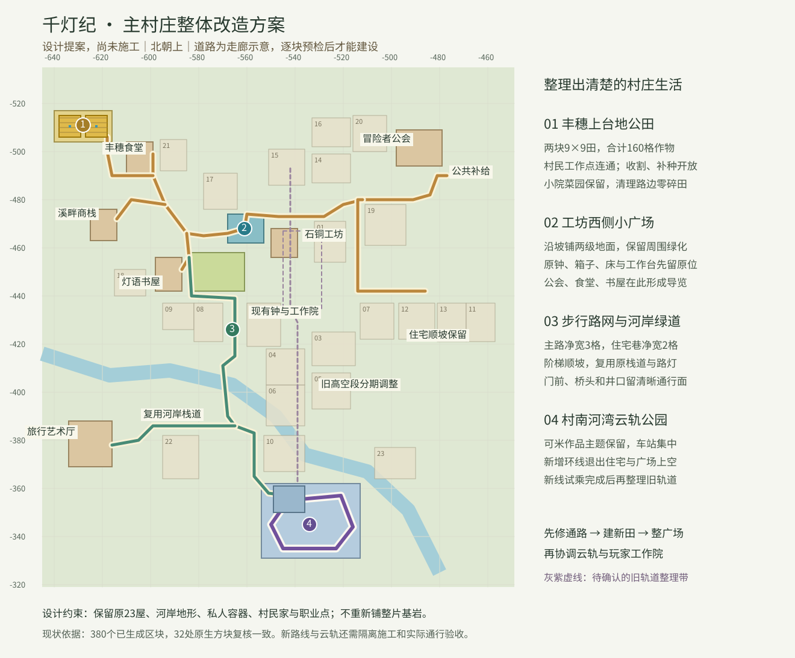

# 主村庄改造：街巷、田园与河湾云轨

**2026-10-16 已在正式 Paper 千灯纪建成。** Paper 1.21.1 / AgentFriend 0.4.42，在线施工和原生保存，没有重启或更换 JAR。FOM 与 Agent 客户端未修改。



图中路线来自实际施工中心线，背景为示意布局。完整地点和验收摘要见 [竣工清单](../content/village-masterplan-20261016.json)；文件用于导览，不能直接作为重复施工脚本。

## 去哪里

| 地点 | 主世界坐标 | 用法 |
| --- | --- | --- |
| 千灯小广场 | 约 **(-561,67,-468)** | 两级顺坡广场，长椅、照明及路牌；原树池、箱子与南侧工作院留原位。 |
| 丰穗公田 | 入口 **(-617,75,-505)** | 西田80格小麦、东田80格胡萝卜，公众可收割补种。 |
| 河湾云轨 | 地面入口 **(-543.5,65,-357.5)** | 沿三折双宽楼梯上站台，上车后按地面按钮，完整环游后自动停车。 |
| 云轨站台 | **(-543.5,80,-356.5)** | 发车按钮 **(-543,80,-356)**；材料箱 **(-538,80,-358)** 归可米。 |
| 旅行艺术厅 | 入口 **(-616.5,67,-378.5)** | 沿河岸艺术步道抵达，原展览玩法继续可用。 |
| 公会公共补给 | 路线终点 **(-474,67,-492)** | 使用原公共箱，补给与回补委托仍走现有任务入口。 |

九条路线连接公共补给、食堂、公田、商栈、书屋、工坊、艺术厅、东侧住宅和云轨入口。本轮整理1774格道路表面，复用原桥、坡道和路灯；道路按真实地形绕行，门前保留原接入，不把住宅削成平地。

## 公田与广场

两块田的土层在 Y=74，作物在 Y=75：

- 小麦田：X=-638..-630，Z=-515..-507，中心含水盖板 **(-634,74,-511)**。
- 胡萝卜田：X=-627..-619，Z=-515..-507，中心含水盖板 **(-623,74,-511)**。

每田9×9，中间一格灌溉、80格种植；含水盖板闭合，边框、田埂、堆肥桶和照明已做好。160格作物经等待和原生保存复核，均稳定生长于湿润耕地。

新田可用后，另把18格无作物的孤立小片耕地恢复成草地。已有作物、成片家庭田、书屋附近的小菜园及原村民工作站保留。没有把“农业”重新设为新手必做路线。

广场范围 X=-568..-554、Z=-474..-463，实际铺130格，两级地坪 Y=66/67。现场新增的箱子和树根周边共50格留空避让；原钟旁箱子、床、熔炉、锻造和附魔工作院保留原位。

## 可米·河湾云轨

新线位于村南 X=-549..-517、Z=-355..-335，104格原版轨道组成闭环，高度 Y=80..86。11处疏放木墩、护栏、雨棚和三折双宽楼梯形成统一车站，不使用命令方块或持续控制任务。

站台用两段连续上坡的失电动力轨刹车。按地面按钮后下坡发车，经过四个弯道和两侧坡道，再回站停住。**独立原生 Paper 副本已实际通过空车、载人整圈和回站停车**，并通过普通生存账号从地面走到站台的检查。手机/Xbox未真机试乘，不将原版方块兼容当作真机验收。

现场按 CoreProtect 最新放置记录逐块确认可米作品，回收346格：普通轨161、动力轨3、圆石169、泥土13。两格原目标已不在，不额外补材料。实际拆下的物品分成8组存入新站台材料箱；先移轨、再移支撑，避免轨道掉落与回收重复。

11辆原空闲矿车已迁入车站或独立围栏泊位，其中一辆用于乘坐；没有新生成矿车。2位普通村民原生下车，原UUID、交易和物品保持；固定说书人及其原车、其他玩家和未知归属轨道、6辆箱子矿车均保留。

## 所属权和开放范围

新广场、公田设施和云轨按**实际设施方块**分成227个合并保护体：广场17、公田14、云轨196。作物、耕地和周边普通草地继续开放，不整片封村。普通账号查询已确认：公田土和作物可操作，灌溉盖板、广场地坪与云轨支柱不可拆。

上层站台领地 `cormy_cloudrail` 属于 **ag_CorMy**，范围 **(-550,79,-362) 至 (-537,87,-351)**，访客可使用按钮等设施；材料箱需主人或协作者权限。归属公告在 **(-552,66,-356)**。9块旧领地和原保护区域保持。

公共传送资格已启用，落点由主人亲自选择，**尚未发布公共传送点**。可米在站台安全位置执行：

```
/mycli landmark publish cormy_cloudrail 河湾云轨
```

发布后大家使用 `/mycli goto landmark:cormy_cloudrail`，每次仍耗6魔力。维护没有冒用可米执行发布或替她移动角色。

## 验收与观察

- 独立副本：实际步行到公田、艺术厅、补给箱；生存、禁止挖放；实际登站、空车/载人整圈及刹车。
- 正式服：23项最终检查通过，160格作物稳定、104格轨道形状与净空正确，6项普通账号权限查询通过。
- 47位原村民、23辆原矿车/箱子矿车均可查；17位固定NPC位置与完整交易数据保持。11252格原建筑掩码的方块类型保持，173个原储物方块均在。
- 施工中玩家持续活动，8处原箱子物品有变化，均有可米/鸣人存取记录，双箱两半一并核对；没有以旧快照覆盖物品。
- 1格旧轨拆除位置后来长出藤蔓，CoreProtect记录为 `#vine` 自然生长，保留。
- 一只原铁傀儡UUID最终不在三维度实体存档。同区同期有僵尸击杀铁傀儡记录，但记录不含UUID，不能单凭此行确定死者。没有补生或复活；另自然生成一只，最终总数仍3只。
- 临时区块全部释放、自动保存恢复；短窗口20TPS，平均13.8ms/tick。这不是16个自主Agent长期负载结论。

## 运维和后续维护

E/F留存施工前后完整**在线快照**：原版保存暂停后flush；SQLite使用在线backup API；独占锁定的LuckPerms H2以完整原生权限导出替代。两份竣工快照各3592文件、约1.80GB并校验镜像；这是可恢复在线快照，不是全服停机后的逐字节冷备。

私有证据在 `repairs/village-rebuild-20261016`，包含逐块前像、命令回执、实际回收账、实体NBT、联机和保存检查、保留的失败尝试；世界、玩家信息和凭据不入公开仓库。

回退只按逐格日志确认当前仍等于本批新值，再撤回相应格；容器与实体单独核对，实体优先操作原活体UUID。不能在线覆盖旧region/entity或玩家文件，也不能整份回写旧领地。整世界恢复会回退后续进度，须另行确认。

农田维护应先清理种植高度的冲突块，等待土层、灌溉和光照稳定后再种，不能把放置成功回执当作作物已存活。常规补种交给玩家/村民，不新增定时强制补成熟作物。

实体路牌、站台说明、领地公告与女神资料已同步。现有补给、工程、摄影和生活任务继续可用；本轮未新增专用云轨养护委托或修改玩家在途任务。原岩基层没有重铺，草地、小菜园和普通树木仍按原权限使用。
