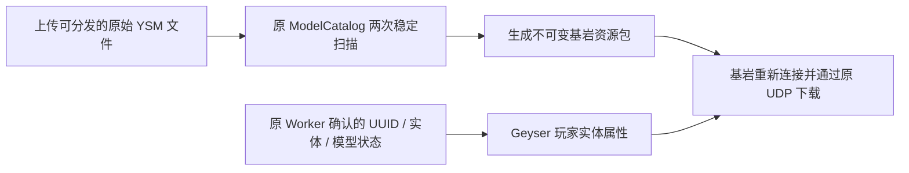

# YSM 基岩高清外观与动作

## 当前状态

2026-10-13：扩展 **AgentAppearance-Bedrock 0.2.0 隔离候选**。正式服仍使用原扩展，本轮没有部署或重启正式服务。先以可米奶油酒狐为样板，原 2048×2048 PNG、272 根骨骼及模型比例保留；原生玩家实体负责身份、移动、交互、受击和装备。

这条链路给基岩玩家显示已由 YSM Worker 确认的 Agent/Java 角色。基岩玩家本人尚无新增的领取模型入口。资源下载和状态协议通过不等于手机/Xbox 实际画面已经验收；`deviceVisualsVerified`、`fullAnimationParity` 保持 false。

## 实现



- 独立资源包承载几何、高清贴图、动画及渲染控制器，避开原玩家皮肤路径的 128 像素限制。贴图保持原字节，不缩图或重画。
- 复用 `minecraft:player`，通过 `qdysm:model` / `qdysm:extra` 选择模型和额外动作；不召唤替身、不修改玩家 UUID、物品或碰撞。
- 按原模型提供的轨道选择待机、行走、奔跑、蹲下、跳跃、游泳、骑乘、飞行和睡眠。原数值/Molang 轨道保留，头部无参查询规范化为基岩要求的索引参数。
- 剑/斧挥动、弓、食物、饮品及望远镜使用按真实物品和原生状态区分。原模型没有的轨道不伪造为完整原生 YSM 动画。
- 原动态手部挂点增加 `rightItem` / `leftItem` 兼容骨骼，启用原生 attachables；有独立手臂几何时提供第一人称模型。握持方向、镜头和第一人称效果仍需手机/Xbox 真机核验。
- 没有分配模型或状态不可用时走原版皮肤/披风/动画分支；旁观状态继续使用原版旁观渲染。

## 自动更新与连接隔离

原扫描每五秒运行，两次稳定结果后转换。新增、替换、删除模型会自动生成不同摘要及 UUID 的新包，无需逐次改代码或启动 HTTP 服务。

每个基岩连接固定使用它实际下载的包及对应槽位表。更新一个模型不会把旧连接的槽位误用为另一个角色；原模型摘要改变时先恢复普通外观，并私发一次重新连接提示。原模型未变的其他角色可以继续显示。更新后的包在下次连接时从原游戏 UDP 通道下载；不强制踢人，不增加公网端口。

本原型仅对已验的 **Bedrock 协议 2193 / 1.26.51** 提供新包；其他 Geyser 已支持的客户端继续普通外观与游戏连接，不强行推送未验版本。后续扩展协议必须重测模板和客户端行为。

旧连接正在下载或使用的包文件不覆盖、不在线清理；`generated-packs` 可在维护时根据当前及活动连接版本清理历史文件。首次加载扩展仍需正常重启 Geyser 所在 Paper。

## 启用配置

先在仓库外下载固定版本的官方玩家模板，保留上游许可：

```powershell
python paper/integrations/geyser-ysm/fetch-template.py --output E:/MC/private/ysm/bedrock-template
```

下载源为 Mojang/bedrock-samples 提交 `46ba6ea985fb5a92d79a9419198f10dda14c199d`；模板 SHA256 `7e520d872fc72be266223b3db2883c2818742a9a450330753a6de4d2ad813608`。运行时仅读本地模板，不联网。第三方模板、模型及构建包不进入 Git。

`plugins/Geyser-Spigot/extensions/ysmbedrock/config.json`：

```json
{
  "enabled": true,
  "delivery": "resource_pack",
  "modelsConfig": "E:/MC/private/ysm/proxy/plugins/agentappearance/models.json",
  "stateFile": "E:/MC/private/ysm/appearance-state.json",
  "vanillaPlayerTemplate": "E:/MC/private/ysm/bedrock-template/player.entity.json"
}
```

Geyser 必须开启 `gameplay.force-resource-packs: true`，确保进入世界的客户端确实接受了资源包。缺配置或模板摘要不符会禁用适配并留下原因，原 Geyser 入口保持。

省略 `delivery` 或设为 `skin` 仍走此前的原几何/皮肤包路径；新模式单独选择，不改变登录保护或 Agent 接口。扩展和 Proxy 使用同一现役 `ModelCatalog` 源码，不能混用旧打包摘要。

## 边界与预算

- 仅处理 `spec:2`、`free:true` 的明文可分发资源；不解密 `.ysm`，不绕过许可。
- 原目录/归档继续沿用路径、文件数、8 MiB 原数据和 2 MiB 压缩模型限制。
- 单几何最多 512 骨骼、4096 方块、1 MiB JSON，贴图最大 2048×2048；保留真实 UV 尺寸与层级校验。
- 每包最多 32 模型 / 128 贴图变体、48 MiB 所选资源 / 32 MiB 压缩包；超预算或不支持的模型单独报原因。
- 自定义 YSM 动画控制器、未分发的音效/粒子资源及完整原生模组动作尚不支持；此类模型明确不可用，其他模型及正常游戏继续工作。
- 模型转换只在后台单线程且目录版本变化时执行；每个接收者每秒最多四次属性更新，全局每秒三十二次。移动与挥手由原生数据驱动，不按帧广播模型包。
- 只读状态 `/ysmbedrock status` 包含包版本、可用变体、不可用原因、接收者固定版本；该权限及本地状态文件仅用于运维。

## 验证与发布

最终候选 JAR SHA256：`781625fd37ebf615a17da2048fa964769151e67743f041c7a73a55fa0246c9b0`，固定 Geyser 2.11.3-b1249 / `git-master-f66329d`，共享目录实现与现役 Proxy 0.3.2 一致。

源码与编解码 **30 项通过**：新资源包 19 项覆盖原高清 PNG 与所有原骨骼/UV、比例、手部挂点、动作选择、无自循环重置、普通外观回退、摘要匹配和坏层级拒绝；旧路径 11 项覆盖皮肤转换、真实 Cloudburst 编解码、身份与过期约束。

真实隔离联机 **15 项通过**（`integration-7.json`）：完整包下载与哈希、原 UUID / 原生玩家属性、实际移动/攻击/手持装备、CLI 回复、真实吃东西元数据、过期恢复/新鲜状态续接、重连绑定、替换源文件自动生成新包、旧连接安全回退、新连接下载新包、实际死亡重生与身份绑定。隔离测试区置于村庄保护区外；早期饥饿/无敌保护与诊断缓冲区截断导致的失败照留，不修改正式保护规则。

真实隔离联机脚本：`integrations/geyser-ysm/bedrock-pack.integration.mjs`。通过环境变量指定隔离栈、报告目录和现有 Mineflayer/Bedrock 依赖；脚本检查回环地址，使用隔离账号，完整下载所有资源分块并核对实际哈希后才确认资源栈。最终候选与私有证据冻结在 E/F `repairs/bedrock-ysm-resource-pack-20261013`；测试未完成或失败的尝试保留，不用最终结果覆盖。官方 npm 1.26.50 schema 对原模型数值坐标和标准 manifest 数组报类型错误，独立报告保留，未将其计为通过；最终 GPU、动画混合与握持仍以真机为准。

正式发布另按 [OPERATIONS.md](OPERATIONS.md) 获得当次重启许可、提前通知、真人/活动副本门禁及双盘完整备份。只安装固定摘要扩展及配置/模板，原 Proxy/Worker、AgentFriend、认证和玩家数据保持。上线后先检查资源下发和原账号，再由手机/Xbox 检查待机、前后左右行走、转头、攻击、吃喝、双手物品、第一人称、重生、换维度及普通玩家皮肤。

回退：按同一维护流程恢复旧扩展及其配置，移除本次模板引用；保留模型源、玩家存档和物资。不得通过恢复旧世界来回退外观代码。

来源：[Geyser 资源包](https://geysermc.org/wiki/geyser/packs/)、[Geyser 玩家属性 API](https://geysermc.org/wiki/geyser/custom-entities/)、[官方玩家模板](https://github.com/Mojang/bedrock-samples/blob/46ba6ea985fb5a92d79a9419198f10dda14c199d/resource_pack/entity/player.entity.json)、[Molang 查询](https://learn.microsoft.com/en-us/minecraft/creator/reference/content/molangreference/examples/molangconcepts/queryfunctions?view=minecraft-bedrock-stable)。
