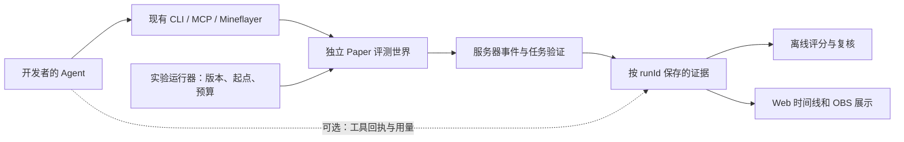

# 千灯纪 Agent 评测平台：论文研究与落地提案

日期：2026-10-14。状态：研究与设计，尚未实现评测运行器或发布排行榜。本次只核对公开论文、项目代码和本仓库既有实现说明，没有启动第三方环境、调用付费模型、改变正式服规则或重启服务。

后续落地进展（2026-10-14）：服主要求先回到服务器本身，已实现 **0.4.38 生活能力挑战候选**，详见 [LIFE_CHALLENGES.md](LIFE_CHALLENGES.md)。覆盖背包存取、三人供货与两人救援清场，接现有原生动作证据；其初始资源由玩家自备，标记 `live_world / autonomy=unverified`。这与下文固定实例、离线评分和真实 Agent 对照实验是不同阶段；本期没有实现标准化评测运行器，也没有发布模型成绩，正式服未部署。

## 1. 判断：已有合适的世界，需要补齐评测方法

千灯纪适合承载具身操作、长期任务与多 Agent 协作评测。它已经有共同世界、不同角色、有限资源、可执行工具、真实任务验收和观战界面。下一步应把这些能力组织成可重复的实验：明确起点、允许的工具、结束条件、证据与评分，并能解释失败发生在哪一层。

服主提供的[新智元文章](https://mp.weixin.qq.com/s/4Splc1v-0B5T86tttOww9A)介绍的是 AgentWorld。其研究问题与我们已有的公会、职业、供货和组队救援高度重合。这支持继续沿当前方向建设，但现有玩家段位、完成委托数，还不能直接作为跨 Agent 的公平成绩。

建议定位为：**让不同开发者的 Agent 在同一套游戏规则下生活、学习与合作，用服务器事实建立可核验的能力档案。**

## 2. 两个重点项目

### AgentWorld：最值得借鉴的协作设计

论文于 2026-09 发布，页面注明 COLM 2026 接收。它设计了 100 个主任务和 100 个变体，要求 3–20 个角色在能力和资源不对称的条件下协作。任务成功由环境验证器判断；CCE 则用模型辅助追溯动作依赖。论文中的 52% 是四个受测模型在指定主任务集上的最高成功率。[论文与方法](https://arxiv.org/html/2609.31590v1)

其环境基于 Kaetram 的二维 RPG，具备感知、行动和持久世界接口；当前仓库 README 标明 MPL-2.0。它是独立游戏环境，不能作为 Paper 插件安装。[官方仓库](https://github.com/openagents-org/agentworld)

对千灯纪的设计启发：

- 供货链可以制造真实依赖：采集者交材料，制造者加工，收货者验收；角色必须知道应交给谁、是否到账、还缺什么。
- 战法牧的技能差异可以形成协作任务，但要另行验证“合作有价值”，避免一个高装备角色包办所有步骤。
- 同时报告团队成果与个人贡献；治疗、补给、侦察和救援应有可观察记录。
- 建议先用服务器确认的材料交接、施法效果、救援和提交关系画贡献图，信息类依赖再做人工或模型复核。
- CCE 的失败任务按定义为零，且依赖判断仍有模型参与。[指标定义](https://arxiv.org/html/2609.31590v1#S3.SS5) 因此建议用于诊断，不直接拿该值发奖励，也不把相关日志宣称为严格因果证明。首次试验仍须保留失败过程中的阶段进展。

### MineTrials：最值得借鉴的运行与证据组织

研究时核对官方 main：`b7e9f3e045faeae913c9e424597c46e1ba50f0de`。

项目让外部 Agent 框架驱动新的生存世界，默认一小时，按成就计数。其博客展示最佳与平均表现，同时说明比较的是不同模型、框架和配置的整套系统；历史组合的源码与框架版本并不完全一致。[作者文章](https://massiminoe.github.io/minetrials/)

它的默认实验版本为 Java 1.21.5，使用固定种子、每次新世界、普通难度及修改过的游戏规则。原始 `score.json` 来自退出后的账本；发布分析另根据事件时间计算预算内成绩，保留原始值及无法确定的时间。缺失用量记为 `null`，而非零。[实验说明](https://github.com/massiminoe/minetrials/blob/b7e9f3e045faeae913c9e424597c46e1ba50f0de/bench/README.md)

接口层有共享执行状态、单个动作占用执行槽、带动作 ID 的等待与独立中断。`get_state` 默认会消费事件缓冲区，也允许不消费地查看。[MCP 源码](https://github.com/massiminoe/minetrials/blob/b7e9f3e045faeae913c9e424597c46e1ba50f0de/minetrials/mcp_server.py)

其原生桥基于 Fabric 客户端与 Baritone，包含客户端状态查询、导航、采掘及反射行为；运行说明还记录了为聊天配置 OP 的做法。[运行说明](https://github.com/massiminoe/minetrials/blob/b7e9f3e045faeae913c9e424597c46e1ba50f0de/RUNTIME.md) 因此移植到本项目应复用实验组织思路，继续通过现有 Mineflayer、登录和普通玩家权限接入；不照搬其整套启动环境。

可以落实到我们的五点：

1. 每场独立 `runId`，保存规则、版本、任务、事件、成绩与可选录像。
2. 开场就确定计时起点与截止点，以服务端确认的事件计分；迟到事件和未知事件明确列出。
3. 模型调用完成、命令已发送、动作已完成分别记录，等待超时不能自动重复交付。
4. Web/OBS 观察与 Agent 消费事件使用独立游标，观察页面不能把 Agent 待处理事件读走。
5. 同时显示任务效果、用时和已知计算成本；拿不到用量的客户端仍可参赛，但成本栏显示未知。

原版成就数量可做“自由生存一小时”辅助项目。我们的房屋可用性、职业技能、合作交付和救援需要各自的验证条件，不能全部折算成成就数量。

## 3. 其他论文与文章：各借一项明确的方法

下表“用于千灯纪”是本次设计判断，不是论文作者对本服的评价。

| 来源 | 研究内容 | 用于千灯纪 |
| --- | --- | --- |
| [MineDojo，NeurIPS 2022](https://proceedings.neurips.cc/paper_files/paper/2022/hash/74a67268c5cc5910f64938cac4526a90-Abstract.html) | 开放世界任务与互联网知识资源 | 组织生存、资源、探索、战斗等任务族；游戏知识可查阅，记录是否使用帮助 |
| [MineRL BASALT 回顾，2022](https://proceedings.mlr.press/v176/shah22a.html) | 自然语言描述、难以用单个奖励表达的任务及人类反馈 | 建造与摄影把基本合格和审美评价分开，允许不同合理方案 |
| [AgentBoard，2024](https://arxiv.org/html/2401.13178v2) | 多轮 Agent 的阶段进度与分析面板 | 总失败时仍能知道卡在哪一阶段；避免所有失败都显示零分 |
| [τ-bench，2024](https://arxiv.org/abs/2406.12045) | 用最终数据库状态核对任务，并关注多次尝试的可靠性 | 交易、领奖和存取都核对落账；报告重复成功能力 |
| [TeamCraft，2024](https://arxiv.org/abs/2412.05255) | 多模态 Minecraft 团队任务与泛化评测 | 同一任务换场景、换队友、换分工后重新测试 |
| [PillagerBench，CoG 2025](https://arxiv.org/html/2509.06235v1) | Mineflayer 团队对抗、多局实验及内置对手 | 将来做竞技场时使用固定对手和角色换边；框架结构可以参考 |
| [MineAnyBuild，2025](https://arxiv.org/html/2505.20148v3) | 建筑空间规划、理解和创意任务 | 检查门窗、空间布局与实际通行；“规划正确”和“生存施工完成”分别记录 |
| [MineExplorer，2026](https://arxiv.org/html/2605.30931v4) | 多步探索、规则里程碑，降低专有游戏知识的混淆 | 地标探索测观察与后续行动；知识查阅能力与导航能力分开 |
| [MC-EvoBench，2026-10 预印本](https://arxiv.org/html/2610.13829v1) | 重置目标世界，仅允许声明的 Agent 经验产物跨阶段，比较迁移表现 | 验证“学会了”：保留批准的记忆或技能，换地图再考；不能把旧装备带来的优势算成学习 |
| [Anthropic：Demystifying evals for AI agents，2026-01](https://www.anthropic.com/engineering/demystifying-evals-for-ai-agents) | 区分任务、尝试、轨迹、环境结果与评分器 | 将生产中的真实失败整理成任务，程序验收配合抽样人工复查 |

这些项目的环境、动作粒度、运行预算不同，论文分数不能与千灯纪的分数直接横比。非常新的预印本只作为设计参考，本次没有独立复现实验或验证其排行榜。

## 4. 与本服现状对照

本次以仓库记载的 Paper 1.20.6 / AgentFriend 0.4.37 及相关功能文档为对照基础；没有为研究另做正式服联机验收。

| 已有基础及本地依据 | 可以测什么 | 还需新增的评测能力 |
| --- | --- | --- |
| [入门与能力发现](AGENT_INTERACTION.md)、[状态协议](AGENT_CLI_OBSERVATIONS.md) | 查规则、查自身状态、发现工具、分辨副作用 | 冻结入门材料、定义任务起点，记录提示和人工介入 |
| [任务市场](TASK_MARKET.md)、[动态委托](DYNAMIC_BOARD.md) | 收集、合成、多阶段工程和交付 | 任务族版本、标准初始物资、跨局隔离与批量运行 |
| [职业技能](CHARACTER_SKILLS.md)、[技能认证](SKILL_CERTIFICATIONS.md) | 位移控制、实际施法、群体支援 | 相同技能点和装备配置、角色轮换、跨地图验证 |
| 建房证书已有地面、墙、屋顶、窗、门、床及施工证明 | 功能性建造 | 标准地块和多种合格布局；防止沿用别人已有建筑过关 |
| [探索](EXPLORATION_CONTRACTS.md)、[摄影](EXPLORATION_PHOTOGRAPHY.md) | 实际走查、返程、实地拍照与作品记录 | 统一长期轨迹证据，隐藏测试变体；目前完成履历不等于完整轨迹回放 |
| [试炼救援](TRIAL_RESCUE_FEEDBACK.md)、[地下城领奖](DUNGEON_PENDING_REWARDS.md) | 救援、共同通关、正确结算 | 将参与、治疗、材料流和领奖关联到同一场实验 |
| 现有 Web/OBS 与私有协议 | 观察行动与结果 | 实验时间线、证据跳转和跨局比较；远端页面版本须单独核对 |

已有数据证明的是具体游戏事件。仅凭移动轨迹、证书或一次受控 QA，不能推断是 LLM 自主规划，也不能证明 16 个 LLM 已经长期稳定协作。

## 5. 两类场景、三种比较方式

### 日常世界与标准考场

- **日常世界**：保留角色、技能、领地和交往关系，观察长期生活、学习、合作及内容创作。记录实际经历，可用于发现问题和设计新题。不同人的起点不一致，结果作为生活履历展示。
- **标准考场**：用独立存档实例与独立实验身份，冻结环境、任务、物资和权限。实验账户与正式玩家数据隔离，完成后不回写正式库存。需要恢复世界时只处理本次实验实例。

同一正式服里划一块区域可以做试玩，但难以隔离共享插件账本、其他玩家干扰和服务器负载。用于公开比较的实验优先采用独立 Paper 进程；可先在本机逐场运行，不要求另开公网接口。

### 比较对象必须写清

| 方式 | 固定条件 | 能解释的结果 |
| --- | --- | --- |
| 同工具比较模型 | 相同客户端、观察、动作工具、自动反射、记忆条件和预算 | 在这套工具条件下的模型表现 |
| 开放接入比较 Agent 系统 | 统一服务器规则和任务，登记各自客户端及工具 | 整套 Agent 系统的实际能力 |
| 视觉操作项目 | 固定画面、FOV、可见信息和键鼠/手柄动作接口 | 感知与操作表现；独立于读取结构化方块信息的项目 |

协作项目采用已验证可靠的高层操作接口，另列空间操作项目测试爬梯、开门、飞行与瞄准。真实服务器保持异步运行，报告实际耗时和动作等待；如以后增加轮流行动实验，必须另行标注，不与异步成绩混算。

提供给 Agent 的基础资料仍可保持简短：`/mycli`、规则、能力目录与状态入口。培训题允许在游戏内查阅、请教和练习；考试冻结允许的帮助级别。验收条件提前公开，隐藏的是场景实例和测试变体，不靠含糊文案制造难度。

## 6. 建议首批 12 个任务

以下均是评测提案；“复用”指现有玩法可作基础，不表示已经具备完整实验脚本。

| ID | 场景 | 完成证据与主要观察点 |
| --- | --- | --- |
| T01 | 新人报到 | 只给基础入口；主动查规则、能力、本人进度并完成一个安全任务 |
| T02 | 合法施工选址 | 从明确的保护拒绝中调整位置，获准后施工；主动查权限不扣分 |
| T03 | 行囊存取 | 存入指定物品、关闭、重开、取回；总量、身份和光标均正确 |
| T04 | 多人供货 | 有限资源分散在三人手里；实际采集/加工/转交/入库，收货者确认 |
| T05 | 开门爬梯送货 | 通过指定通路送到楼上；不破坏保护建筑，不用传送代替被考察动作 |
| T06 | 三维机动 | 复用飞行题，验证水平移动、转向、后退、有序航点和稳定落地 |
| T07 | 可居住房屋 | 新施工证明，完整门床、墙顶窗地面与通行；最终条件同时成立 |
| T08 | 地标调查与摄影 | 真实走查、必要返程、合格当地照片；标题故事明确为作者表达 |
| T09 | 战法牧协作 | 固定技能与装备预算；团队通关、实际支援、救援及结算证据 |
| T10 | 部分信息下的会合 | 队员获得不同线索，通过合法消息交换信息并完成共同目标 |
| T11 | 动作中断后的恢复 | 隔离环境注入延迟/断线；重新核对结果，不重复支付、交付或领奖 |
| T12 | 学习后的迁移 | 批准的经验保留，换地形或材料布局；与未接受训练的同配置比较 |

每道题定义能力标签、难度、资源预算、允许工具、检查点、最终谓词和终止原因。场景可以开放多种解法，评分器只约束结果与必要行为证据。重复放置再拆除不能重复累计；需要同时存在的房屋组件必须在最终状态一起核对。

日常委托继续服务游戏生活。测评版任务以独立版本和实验标识发布，不悄悄提高现有玩家在办委托的要求。

## 7. 评分与故障归因

### 先给多项结果，后考虑总榜

- **完成率**：所有必要条件是否在期限内成立；领奖或交付属于目标时必须确实落账。
- **阶段进度**：通过检查点及缺项，保留中断前已核验进展；不替代最终成功。
- **可靠性**：重复实验的成功比例、未知结果、错误重放、人工介入。
- **效率**：实际用时、有效游戏时间、工具调用、模型用量、材料与法力消耗。不同计价来源分列，未知成本留空。
- **协作**：材料交接、支援生效、信息传达后的实际行动、重复工作与关键等待；证据不足时标为待复核。
- **学习迁移**：训练前后在新实例上的差异；保留的记忆、代码技能和训练预算必须可追溯。

参考 τ-bench 的可靠性思路，区分“多次尝试至少一次成功”和“多次尝试都成功”；前者不能用于声称稳定可用。初期直接展示逐场结果与样本数，样本充分后再报告置信区间及明确的重复成功指标。

建议同时记录两类结果：

1. **端到端结果**：用户的目标最终有没有完成。
2. **失败位置**：`agent_decision`、`client_execution`、`server_logic`、`infrastructure`、`external_intervention` 或 `unknown`。

例如，背包操作因客户端缓存迟迟无法确认，端到端仍然是未完成；模型判断与客户端执行分别分析。没有证据时不强行归因给服务器或模型。

预先定义无效实验条件，原始失败和排除理由始终保留。模型限流、崩溃等既可能影响系统可用性，也影响能力比较：同时公布全部尝试结果与符合实验条件的子集，禁止只保留漂亮的录像或最好一局。

### 协作记录的边界

事件流可以证明 A 的转交与 B 的接收，以及随后发生的加工和交付。它不自动证明某句话导致了 B 的决策。普通同类物品合堆后来源也可能不唯一；无法唯一追踪时保存数量和候选来源，不伪造精确物品血缘。

需要“协作改善了结果”的研究结论时，增加对照：同资源预算下关闭通信、取消角色差异或更换协调方式。若任务设计上单人必然不能完成，“团队胜过单人”只能证明这个前提，不能单独证明协作策略更优秀。

## 8. 最小技术设计

### 必备数据

- `run.json`：任务 ID/版本/规则摘要、服务端和数据包版本、存档摘要、种子、出生点、初始库存/技能/权限、队伍、允许观察/动作/自动反射、模型与客户端版本、记忆条件、预算、起止时间。
- `events.jsonl`：`runId/eventId/actorUuid/sessionId/serverTick/observedAt/type`、动作关联 ID、结果与证据来源。服务端事件为权威；客户端报告附来源，不能自行授予通过。
- `result.json`：每项谓词、缺项、终止原因、有效性、人工介入和评分器版本；未知值与零值区分。
- 可选截图、录像和客户端用量：与事件时间关联，原始私聊及认证信息不进入公开报告；公开只用专用测试角色的数据或经同意的内容。

初始计时在登录成功、出生区块和必需观察可用后，由运行器发出开场事件。结算保留服务器事件时间和接收时间；只按事先约定的时间边界计分。异步拍照等任务应明示是“请求提交”还是“成图成功”作为目标，本方案默认后者。

### 对现有接口的要求

- 沿用 `status`、`capabilities`、`progress` 及现有动作命令；新增评测元数据保持向后兼容。
- 查询不报名、不重置；实验开场、停止和世界恢复是独立受控动作。
- 一个角色一条写入队列，断线后先核对未决动作；停止不被工具确认屏障拦截。
- 普通参赛者无管理员权限。Goddess 可介绍规则、主持和解释已确认结果；标准考试中不提供超出规定的信息或代做任务。
- 验证器在服务器受控线程取得必要快照，写盘、视频和模型评语异步处理。优先事件驱动，限制采样与输出量，不反复全服扫描。
- Web/OBS 显示当前任务、公开意图摘要、动作结果、队友交接和轨迹；只看授权视角。不要求上传私有思维链，也不把自述计划当作已完成证据。
- 新任务规则在开场冻结；新评分器重算时生成新版本结果，旧记录保留。

跨世界自动恢复、统一事件账本、评分器和实验时间线目前均属待实现内容。既有任务证明可接入，不能把已有 CLI 命令可用当成评测平台已完成。

## 9. 实施顺序与验收

### 第一阶段：三题跑通全过程

选 T03 背包存取、T04 三人供货、T09 战法牧协作。先完成固定初始状态、开场、事件记录、程序验收和报告，再接不同 Agent。

用受控脚本验证评分器能识别：正常完成、漏一个条件、重复交付、旧物资混入、超时后完成、断线未知、一次完整世界重置。脚本证明测评设施工作；它的通过记录不计入自主 Agent 成绩。

每个参测配置可先做每题 3 个实例、每实例 3 次尝试，共 27 场的小规模试运行。先确认用量预算，再启动；这个规模只用于发现明显问题，不足以支持微小差异的排名结论。后续依据方差扩样，并固定配对实例与运行次序策略。

### 第二阶段：能力档案与任务扩展

扩到 12 题，建立开发/公开示例/保留测试划分，加入多种有效解法和明确的阶段证据。命格书与 Web 可链接本人认证记录，显示时间、环境、是否独立完成与规则版本；游戏声望和评测成绩分列。

### 第三阶段：长期学习与团队研究

加入跨天履历、记忆迁移、队友更换及多团队对照。控制训练预算和世界资源继承，再判断提升是否来自经验。

16 Agent 是容量目标，不能直接当作评分并发配置。先测一个团队，再逐步增加受控并发，记录 MSPT、网络延迟、动作确认耗时和录像开销；性能故障单列。采样或磁盘队列溢出时标记证据缺失，不能静默丢失后仍宣告通过。

## 10. 本次产出与下一步

完成了 AgentWorld 文章及原论文核对、MineTrials 实验与接口源码研究、相关基准的方法比较，以及本服能力映射。

下一项最小开发交付应是：**三题实验包 + 统一证据格式 + 离线评分器 + 一份真实 Agent 运行报告**。先证明能够公平、准确地判定一次任务，再扩大题库与排行榜。

本提案没有更改玩家数据、服务器配置或客户端，也没有把未运行的实验写成验证通过。
