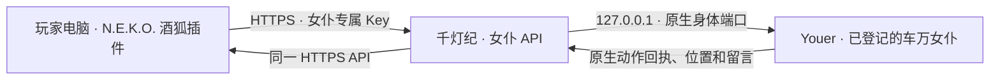

# 让桌面 N.E.K.O. 通过 HTTPS 接入车万女仆

桌面插件默认支持 [千灯纪官网授权](WEBSITE.md)。本页说明手动 Key 和原生端口的接线，两种授权方式共用身体 API。

原女仆实体留在 Youer。服务端继续处理归属、独占租约、原生动作和持久回执。玩家电脑上的 N.E.K.O. 发出工具调用，也可以接收这只女仆收到的主人留言。



## 玩家端

1. 在 N.E.K.O. 插件管理器导入千灯纪版 `.neko-plugin`。包内含 Python 身体适配器，使用 N.E.K.O. 自带的 HTTPX 和 Pydantic。此版本沿用 `neko_tlm` 插件 ID，已有同 ID 插件时用新版替换。联测的宿主是 Project N.E.K.O. 0.9.0，提交 `fb2a2e7`。 [N.E.K.O. 插件配置面板](https://github.com/Project-N-E-K-O/N.E.K.O/blob/fb2a2e7/docs/zh-CN/plugins/plugin-toml.md#配置面板的-json-schema)
2. 手动接入时，将服主提供的 Key 文件保存在自己的私有目录。在插件的「配置」页填写手动 API 地址、Key 文件的本机绝对路径和要控制该身体的 N.E.K.O. 角色名。可勾选转发游戏内主人留言。
3. 保存后启动插件。选中指定角色，说「看看女仆在哪里」核对实体状态。用 `body_connection` 查看是否为 `ready`。插件从 API 取得分配的原女仆和原主人 UUID。

源码调试可继续用 `QIANDENGJI_NEKO_MAID_CONFIG` 指定一个绝对路径 JSON。HTTPS 模式可省略两个 UUID，也可以同时填写作为额外校验。私有 CA 联测可在这个 JSON 设置 `ca_file` 的绝对路径。

## 服务端

1. 启用千灯纪现有的 `qiandengji-maid-body/v1` 原生端口，在服务端登记已存在的私人女仆及原归属，加载对应实体。核对原生绑定中的 `maidId` 和 `ownerId` 后再发放 Key。
2. 在服务端的私有目录生成一个新 Key 文件。以下命令只在终端输出 Key 的 SHA-256。将 Key 文件私下交给这只女仆的主人。

   ```powershell
   node maid-api.mjs issue D:/private/maid-keys/player.key
   ```

3. 将输出的散列和对应 UUID、到期时间填入 `grants.example.json` 的私有副本。其中每条授权包含 `keySha256`、`ownerId`、`maidId` 和 `expiresAt`。到期时间采用带时区的 ISO 8601 格式，例如 `2026-12-01T00:00:00Z`。轮换时为归属相同的女仆生成新 Key，然后移除旧授权。用原子替换更新授权文件，进程会重新读取授权。
4. 修改 `maid-api.example.json` 的私有副本，设置本机原生端口和原生 token 文件，以及授权文件的绝对路径。用 Node.js 22 启动服务。

   ```powershell
   node maid-api.mjs D:/private/maid-api.json
   ```

5. 在已有 HTTPS 域名的 Nginx `server` 里加以下路由。公开地址示例为 `https://game.example.org/api/v1/maid-body`。反代用正常签发的域名证书。把 `19088` 改成转发服务的 `port`，原生 `/maid-body` 保持绑定在 Youer 的本机端口。请保持该路由的 Authorization 头和请求体独立于访问日志。 [Nginx 反代模块](https://nginx.org/en/docs/http/ngx_http_proxy_module.html)

   ```nginx
   location = /api/v1/maid-body {
       client_max_body_size 16k;
       proxy_pass http://127.0.0.1:19088;
       proxy_set_header Authorization $http_authorization;
       proxy_connect_timeout 2s;
       proxy_read_timeout 15s;
       proxy_next_upstream off;
       proxy_cache off;
   }
   ```

进程先校验 Key 再转发动作，Youer 仍会检查原实体和当前控制代次。到期或移除授权后，后续请求返回 `401`，转发服务会在下一次扫描尝试释放它已知的租约和在途寻路。若转发服务失去响应，Youer 负责清理最后一次续约后的原生租约，现行上限为 120 秒。已有动作仍可用原请求号查询。使用主人菜单取回控制后，桌面插件收到拒绝时会撤下工具，重新接管需要手动启动插件。

## API 约定

所有操作使用同一个 `POST /api/v1/maid-body`，请求头为 `Authorization: Bearer <女仆 Key>` 和 `Content-Type: application/json`。

| `operation` | 请求字段 | 作用 |
| --- | --- | --- |
| `identity` | 只传 `operation` | 返回 `protocol`、`ownerId` 和 `maidId`。 |
| `bind` | 客户端生成的 UUID `controllerId` | 获取独占租约和 `generation`。返回当前允许的 `mc_maids` 动作定义。 |
| `call` | `controllerId`、`generation`、`name: "mc_maids"`、`arguments` | 观察、移动、随行、停止、任务和装备设置、私人伙伴法术、留言和游戏内回复。每个写操作在请求外层和 `arguments` 内使用同一个唯一 `requestId`，最多 48 个字母、数字、下划线或连字符。 |
| `release` | `controllerId`、`generation` | 释放此次独占租约并停止其在途动作。 |

`bind`、`call` 和 `release` 可省略原主人和女仆 UUID，由 Key 对应的授权决定。传入与授权不同的 UUID 会得到 `403`。同一具身体正在使用其他控制器时会得到 `409`。走路返回 `accepted` 或 `running` 后，以 `call` 的 `{"action":"receipt","operationId":"原请求号"}` 查询。确认到达需回执中的 `completed`、`goalCompleted` 和实际坐标。连接中断时查询原请求号以核对执行状态。
